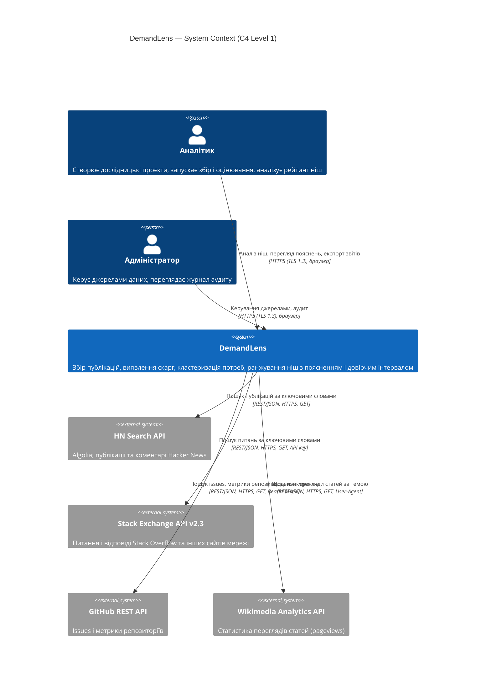
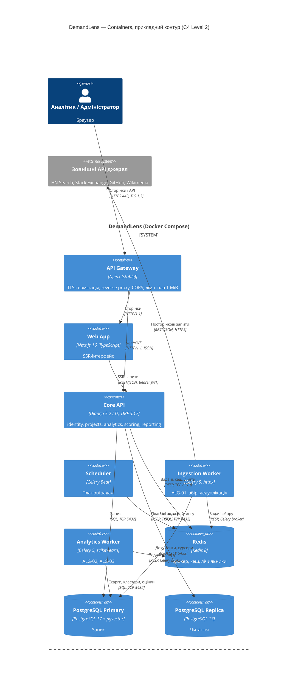
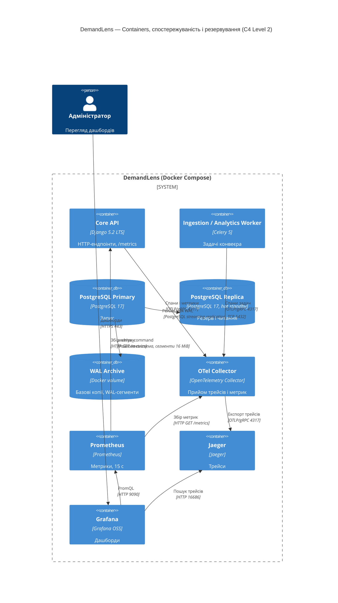

# РОЗДІЛ 2. ОБҐРУНТУВАННЯ АРХІТЕКТУРНИХ РІШЕНЬ ТА ПРОЄКТУВАННЯ СИСТЕМИ

Вимоги, на які посилається розділ, зафіксовано в [специфікації SRS](srs.md); архітектурні рішення — у
реєстрі [ADR](adr/0001-choice-of-technology.md).

## 2.1. Обґрунтування архітектурного стилю та патернів проєктування

### 2.1.1. Реєстр архітектурних рішень

| ID | Рішення | Статус | Вимоги |
|---|---|---|---|
| [ADR-001](adr/0001-choice-of-technology.md) | Асинхронний конвеєр обробки на Celery + Redis у межах модульного моноліту замість брокера подій Apache Kafka або RabbitMQ | Approved | [SRS-NFR-PERF-03](srs.md#srs-nfr-perf-03), [SRS-NFR-REL-03](srs.md#srs-nfr-rel-03), [SRS-NFR-SCAL-01](srs.md#srs-nfr-scal-01) |

## 2.2. Контекстне та контейнерне моделювання системи (C4 Model: Levels 1–2)

### 2.2.1. Діаграма контексту (C4 Level 1)

Опис елементів діаграми контексту:

| Елемент | Тип | Взаємодія і протокол | Вимоги |
|---|---|---|---|
| Аналітик | Person | Браузер → DemandLens через HTTPS (TLS 1.3) | [SRS-FUN-04](srs.md#srs-fun-04)–[SRS-FUN-21](srs.md#srs-fun-21) |
| Адміністратор | Person | Браузер → DemandLens через HTTPS (TLS 1.3) | [SRS-FUN-23](srs.md#srs-fun-23), [SRS-FUN-24](srs.md#srs-fun-24) |
| DemandLens | Software System | Єдина межа відповідальності: збір, аналіз, ранжування | [SRS](srs.md) |
| HN Search API | External System | REST/JSON через HTTPS, без ключа, ≤ 80 % від 10 000 запитів/год | [SRS-FUN-08](srs.md#srs-fun-08), [SRS-NFR-COMP-02](srs.md#srs-nfr-comp-02) |
| Stack Exchange API | External System | REST/JSON через HTTPS, ключ StackApps, ≤ 80 % від 10 000 запитів/добу | [SRS-FUN-08](srs.md#srs-fun-08) |
| GitHub REST API | External System | REST/JSON через HTTPS, Bearer token, ≤ 80 % від 5 000 запитів/год | [SRS-FUN-08](srs.md#srs-fun-08), [SRS-FUN-15](srs.md#srs-fun-15) |
| Wikimedia Analytics API | External System | REST/JSON через HTTPS, послідовні запити з User-Agent | [SRS-FUN-08](srs.md#srs-fun-08) |

### 2.2.2. Діаграма контейнерів (C4 Level 2)

Діаграму рівня 2 подано у двох представленнях одного набору контейнерів: прикладний контур
(рисунок 2.2) і контур спостережуваності та резервування даних (рисунок 2.3). Розподіл зменшує
кількість зв'язків на одній діаграмі і зберігає читабельність підписів протоколів.

Опис контейнерів і трасування вимог:

| Контейнер | Технологія | Відповідальність | Протоколи | Вимоги і рішення |
|---|---|---|---|---|
| API Gateway | Nginx | TLS-термінація, reverse proxy, CORS, ліміт тіла 1 MiB, ліміт з'єднань на IP | HTTPS 443 → HTTP/1.1 | [SRS-NFR-SEC-04](srs.md#srs-nfr-sec-04), [SRS-NFR-SEC-05](srs.md#srs-nfr-sec-05) |
| Web App | Next.js 16 | SSR-інтерфейс; токени зберігаються в cookie `HttpOnly`, `Secure`, `SameSite=Strict` | HTTP/1.1, REST/JSON | [SRS-FUN-04](srs.md#srs-fun-04)–[SRS-FUN-21](srs.md#srs-fun-21) |
| Core API | Django 5.2 LTS + DRF 3.17 | Видача JWT, RBAC, CRUD проєктів, постановка задач, видача рейтингу і пояснень | REST/JSON, SQL, RESP, OTLP | [SRS-FUN-01](srs.md#srs-fun-01)–[SRS-FUN-07](srs.md#srs-fun-07), [SRS-FUN-13](srs.md#srs-fun-13), [SRS-FUN-14](srs.md#srs-fun-14), [SRS-FUN-16](srs.md#srs-fun-16), [SRS-FUN-17](srs.md#srs-fun-17), [SRS-FUN-19](srs.md#srs-fun-19)–[SRS-FUN-25](srs.md#srs-fun-25), [SRS-NFR-PERF-01](srs.md#srs-nfr-perf-01) |
| Scheduler | Celery Beat | Плановий збір, очищення даних старших за 180 діб | RESP | [SRS-NFR-COMP-01](srs.md#srs-nfr-comp-01) |
| Ingestion Worker | Celery 5 | ALG-01: збір з токен-бакетом, backoff, Circuit Breaker; дедуплікація; псевдонімізація; метрики конкурентів | RESP, SQL, HTTPS | [SRS-FUN-08](srs.md#srs-fun-08)–[SRS-FUN-10](srs.md#srs-fun-10), [SRS-FUN-15](srs.md#srs-fun-15), [SRS-NFR-REL-03](srs.md#srs-nfr-rel-03), [SRS-NFR-REL-04](srs.md#srs-nfr-rel-04), [ADR-001](adr/0001-choice-of-technology.md) |
| Analytics Worker | Celery 5 + scikit-learn | Виявлення скарг, ALG-02, ALG-03 | RESP, SQL | [SRS-FUN-11](srs.md#srs-fun-11), [SRS-FUN-12](srs.md#srs-fun-12), [SRS-FUN-17](srs.md#srs-fun-17), [SRS-FUN-18](srs.md#srs-fun-18), [SRS-NFR-SCAL-01](srs.md#srs-nfr-scal-01), [ADR-001](adr/0001-choice-of-technology.md) |
| Redis | Redis 8 | Черги Celery, кеш Cache-Aside (TTL 300 с), лічильники лімітів | RESP | [SRS-NFR-PERF-01](srs.md#srs-nfr-perf-01), [SRS-NFR-SEC-04](srs.md#srs-nfr-sec-04) |
| PostgreSQL Primary / Replica / WAL Archive | PostgreSQL 17 + pgvector | Збереження, реплікація, WAL-архів | SQL, streaming replication | [SRS-NFR-REL-02](srs.md#srs-nfr-rel-02) |
| OTel Collector, Prometheus, Jaeger, Grafana | OpenTelemetry, Prometheus, Jaeger, Grafana | Трейси, метрики, дашборди | OTLP/gRPC, HTTP | [SRS-NFR-OBS-01](srs.md#srs-nfr-obs-01), [SRS-NFR-REL-01](srs.md#srs-nfr-rel-01) |

## 2.3. Компонентне моделювання та опис серверного ядра (C4 Model: Level 3)

Для декомпозиції обрано контейнер Core API: він є точкою входу всіх сценаріїв користувача, містить
контур безпеки (автентифікація, RBAC, rate limiting) і узгоджує синхронний REST-інтерфейс з
асинхронним конвеєром. Діаграма відображає контекст Scoring & Explanation; інші модулі (projects,
analytics, reporting) мають ту саму шарову структуру.

```mermaid
C4Component
    title Core API — Scoring & Explanation (C4 Level 3)
    Container(gw, "API Gateway", "Nginx", "Reverse proxy")
    Container(ana, "Analytics Worker", "Celery 5", "Виконує ALG-03")
    ContainerDb(redis, "Redis", "Redis 8", "Брокер, кеш, лічильники")
    ContainerDb(pg, "PostgreSQL Primary", "PostgreSQL 17", "Запис")
    ContainerDb(pgr, "PostgreSQL Replica", "PostgreSQL 17", "Читання")
    Container(otel, "OTel Collector", "OpenTelemetry", "Трейси")
    Container_Boundary(api, "Core API (Django REST Framework)") {
        Component(obs, "ObservabilityMiddleware", "OpenTelemetry SDK, prometheus_client, structlog", "trace_id, метрики HTTP, JSON-логи")
        Component(authn, "JWTAuthentication", "DRF Authentication", "Перевірка підпису RS256, exp, iss, aud")
        Component(throttle, "UserRateThrottle", "DRF Throttle", "100 запитів/хв на користувача")
        Component(guard, "RoleAndOwnershipPermission", "DRF Permission (Guard)", "RBAC і належність проєкту, 403/404")
        Component(ctrl_run, "ScoringRunController", "DRF ViewSet", "POST /projects/{projectId}/scoring-runs")
        Component(ctrl_niche, "NicheController", "DRF ViewSet", "GET /niches, GET /niches/{nicheId}/explanation")
        Component(dto, "Request/Response DTO", "DRF Serializers", "Валідація полів, заборона невідомих полів")
        Component(errh, "GlobalExceptionHandler", "DRF exception_handler", "Доменні винятки → Error (RFC 9457-сумісна схема)")
        Component(svc_run, "ScoringRunService", "Application Service", "Створення запуску оцінювання, ідемпотентність")
        Component(svc_query, "RankingQueryService", "Application Service", "Ранжований список, пагінація, Cache-Aside")
        Component(expl, "ExplanationAssembler", "Domain Service", "Внески критеріїв, докази, аргументи, ризики")
        Component(ports, "Ports", "Python Protocol", "NicheRepositoryPort, ScoreRepositoryPort, TaskPublisherPort, CachePort, AuditPort")
        Component(repo, "Django ORM Repositories", "Outbound Adapter", "Запис у primary, читання з replica (database router)")
        Component(cache, "RedisCacheAdapter", "Outbound Adapter, django-redis", "TTL 300 с, інвалідація після оцінювання")
        Component(pub, "CeleryTaskPublisher", "Outbound Adapter, Celery client", "Публікація задачі run_scoring")
        Component(audit, "AuditEventWriter", "Outbound Adapter", "Запис подій аудиту")
    }
    Rel(gw, obs, "Запит", "HTTP/1.1, Bearer JWT")
    Rel(obs, authn, "Передача запиту", "Django middleware chain")
    Rel(authn, throttle, "Автентифікований користувач", "DRF request pipeline")
    Rel(throttle, guard, "Запит у межах ліміту", "DRF request pipeline")
    Rel(guard, ctrl_run, "Дозволений запит", "DRF dispatch")
    Rel(guard, ctrl_niche, "Дозволений запит", "DRF dispatch")
    Rel(ctrl_run, dto, "Валідація тіла", "Виклик серіалізатора")
    Rel(ctrl_niche, dto, "Мапінг відповіді", "Виклик серіалізатора")
    Rel(ctrl_run, svc_run, "Команда StartScoring", "Виклик через DI")
    Rel(ctrl_niche, svc_query, "Запит ListNiches", "Виклик через DI")
    Rel(ctrl_niche, expl, "Запит GetExplanation", "Виклик через DI")
    Rel(svc_run, ports, "Збереження запуску, публікація задачі, аудит", "Інтерфейси портів")
    Rel(svc_query, ports, "Читання рейтингу, кеш", "Інтерфейси портів")
    Rel(expl, ports, "Читання компонентів оцінки і доказів", "Інтерфейси портів")
    Rel(repo, ports, "Реалізує", "Dependency Inversion")
    Rel(cache, ports, "Реалізує", "Dependency Inversion")
    Rel(pub, ports, "Реалізує", "Dependency Inversion")
    Rel(audit, ports, "Реалізує", "Dependency Inversion")
    Rel(repo, pg, "INSERT/UPDATE", "SQL, TCP 5432")
    Rel(repo, pgr, "SELECT", "SQL, TCP 5432")
    Rel(cache, redis, "GET/SET", "RESP, TCP 6379")
    Rel(pub, redis, "LPUSH задачі", "RESP, TCP 6379")
    Rel(ana, redis, "Отримання задачі run_scoring", "RESP, TCP 6379")
    Rel(errh, obs, "Логування помилки з trace_id", "Виклик")
    Rel(obs, otel, "Спани і метрики", "OTLP/gRPC 4317")
    UpdateLayoutConfig($c4ShapeInRow="4", $c4BoundaryInRow="1")
```

Опис компонентів за шарами:

| Шар | Компонент | Відповідальність | Інваріант / механізм | Вимоги |
|---|---|---|---|---|
| Cross-cutting | ObservabilityMiddleware | Створення спану, метрики `http_server_duration_seconds`, JSON-лог з trace_id | Перший і останній у ланцюжку middleware | [SRS-NFR-OBS-01](srs.md#srs-nfr-obs-01) |
| Inbound | JWTAuthentication | Перевірка підпису RS256, `exp`, `iss`, `aud` | Невалідний токен — 401 до виконання бізнес-логіки | [SRS-NFR-SEC-01](srs.md#srs-nfr-sec-01) |
| Inbound | UserRateThrottle | Лічильник у Redis, ковзне вікно 60 с | Перевищення — 429 з `Retry-After` | [SRS-NFR-SEC-04](srs.md#srs-nfr-sec-04) |
| Inbound (Guard) | RoleAndOwnershipPermission | Роль з JWT і належність проєкту | Недостатня роль — 403; чужий проєкт — 404 | [SRS-FUN-03](srs.md#srs-fun-03), [SRS-NFR-SEC-03](srs.md#srs-nfr-sec-03) |
| Inbound | ScoringRunController, NicheController | Маршрутизація HTTP, без бізнес-логіки | Звертаються лише до сервісів, не до ORM | [SRS-FUN-17](srs.md#srs-fun-17), [SRS-FUN-19](srs.md#srs-fun-19), [SRS-FUN-20](srs.md#srs-fun-20) |
| Inbound | Request/Response DTO | Валідація типів, діапазонів, патернів; явний перелік полів | Невідомі поля відхиляються (захист від Mass Assignment) — 422 | [SRS-FUN-04](srs.md#srs-fun-04) |
| Inbound | GlobalExceptionHandler | Єдина схема помилки з `code`, `message`, `trace_id` | Стек викликів не повертається клієнту | [SRS-NFR-OBS-01](srs.md#srs-nfr-obs-01) |
| Core | ScoringRunService | Створення `scoring_run` у транзакції, публікація задачі після commit | Транзакційний порядок: запис → `on_commit` → публікація | [SRS-FUN-17](srs.md#srs-fun-17), [ADR-001](adr/0001-choice-of-technology.md) |
| Core | RankingQueryService | Список ніш за рейтингом, пагінація, Cache-Aside | Ключ кешу містить `scoring_run_id`, тому кеш не повертає застарілий рейтинг | [SRS-FUN-20](srs.md#srs-fun-20), [SRS-NFR-PERF-01](srs.md#srs-nfr-perf-01) |
| Core | ExplanationAssembler | Збирання пояснення зі збережених компонентів | Сума внесків = рейтинг ± 0,01 | [SRS-FUN-19](srs.md#srs-fun-19), [SRS-NFR-EXPL-01](srs.md#srs-nfr-expl-01) |
| Core | Ports | Інтерфейси доступу до даних, кешу, черги, аудиту | Ядро не імпортує Django ORM, Redis чи Celery | Clean Architecture, DIP |
| Outbound | Django ORM Repositories | Реалізація репозиторіїв; database router: запис у primary, читання з replica | Параметризовані запити ORM, без сирого SQL з конкатенацією | [SRS-NFR-REL-02](srs.md#srs-nfr-rel-02) |
| Outbound | RedisCacheAdapter | Кеш рейтингу і пояснень | TTL 300 с | [SRS-NFR-PERF-02](srs.md#srs-nfr-perf-02) |
| Outbound | CeleryTaskPublisher | Публікація задачі `run_scoring` | Задача містить лише `scoring_run_id` | [ADR-001](adr/0001-choice-of-technology.md) |
| Outbound | AuditEventWriter | Запис події аудиту в тій самій транзакції | Подія не записується для невдалої транзакції | [SRS-FUN-22](srs.md#srs-fun-22) |

## 2.4. Контур безпеки програмного рішення (Application Security)

## 2.5. Специфікація міжсервісних контрактів та топологія API-маршрутів

## 2.6. Моделювання користувацького досвіду та транзакційних сценаріїв (Use Cases)

## 2.7. Проєктування та документування моделей даних

## 2.8. Інтеграційний аудит та висновок про готовність архітектури до реалізації

## Висновки до розділу 2
