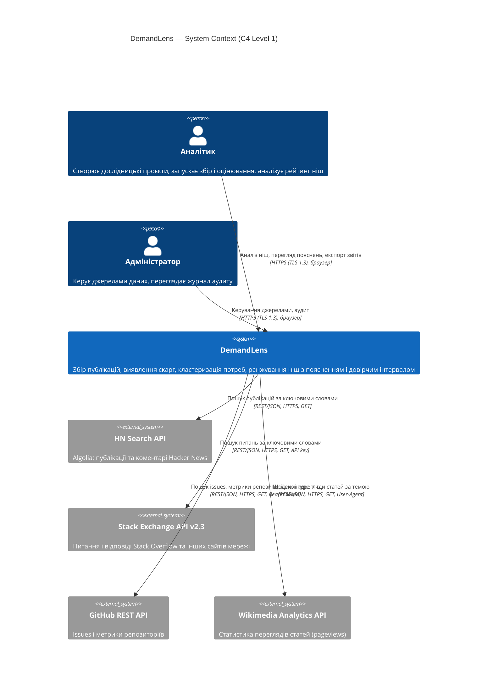
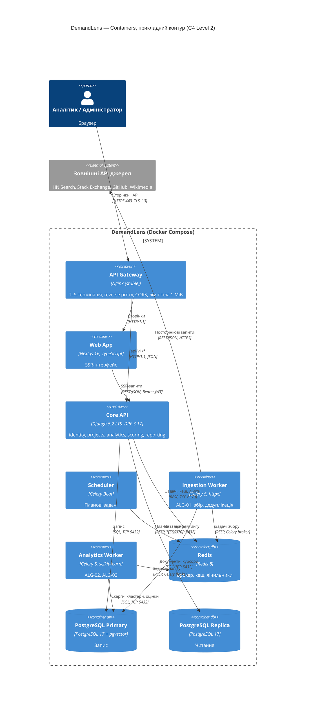
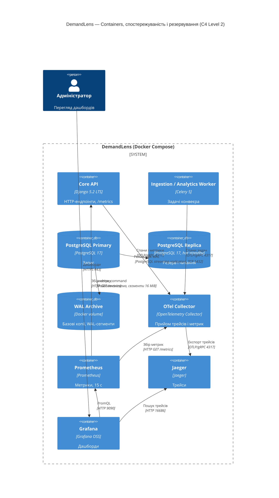
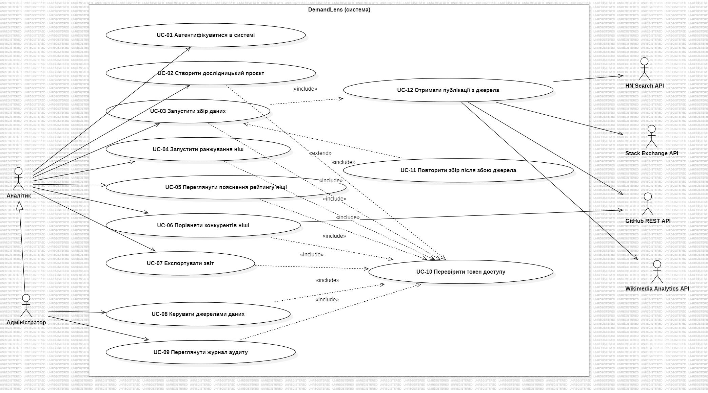
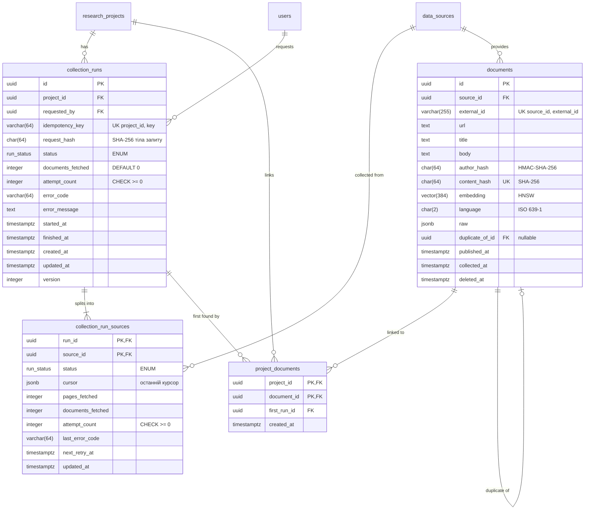
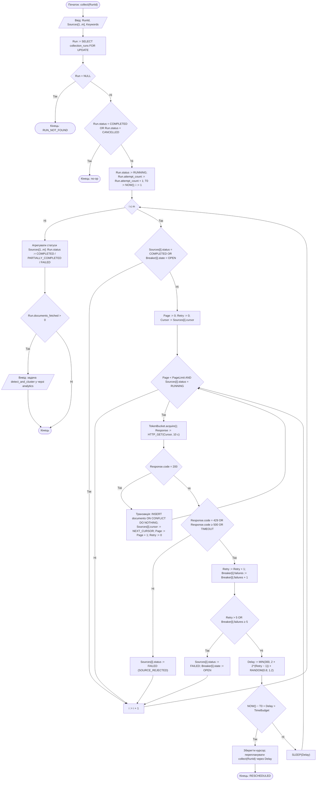
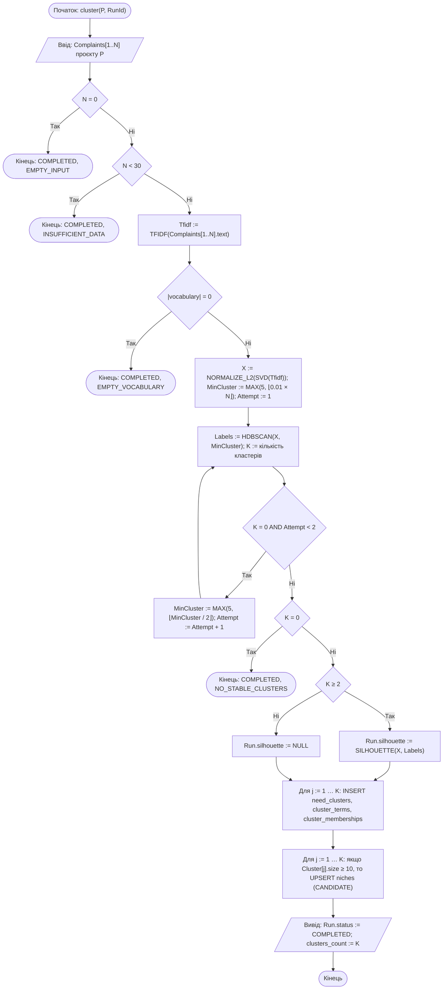
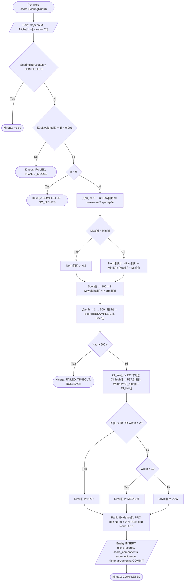

# РОЗДІЛ 2. ОБҐРУНТУВАННЯ АРХІТЕКТУРНИХ РІШЕНЬ ТА ПРОЄКТУВАННЯ СИСТЕМИ

Вимоги, на які посилається розділ, зафіксовано в [специфікації SRS](srs.md); архітектурні рішення — у
реєстрі [ADR](adr/0001-choice-of-technology.md).

## 2.1. Обґрунтування архітектурного стилю та патернів проєктування

### 2.1.1. Реєстр архітектурних рішень

| ID | Рішення | Статус | Вимоги |
|---|---|---|---|
| [ADR-001](adr/0001-choice-of-technology.md) | Асинхронний конвеєр обробки на Celery + Redis у межах модульного моноліту замість брокера подій Apache Kafka або RabbitMQ | Approved | [SRS-NFR-PERF-03](srs.md#srs-nfr-perf-03), [SRS-NFR-REL-03](srs.md#srs-nfr-rel-03), [SRS-NFR-SCAL-01](srs.md#srs-nfr-scal-01) |

### 2.1.2. Глобальний архітектурний стиль

Для системи DemandLens обрано модульний моноліт з асинхронним конвеєром обробки даних. Core API на
Django REST Framework є єдиним розгортуваним вебпроцесом із чіткими межами модулів `identity`,
`projects`, `ingestion`, `analytics`, `scoring`, `reporting`; модулі взаємодіють лише через публічні
сервіси і порти, а не через спільні моделі ORM. Тривалі операції винесено в два окремі контейнери
Celery — Ingestion Worker (I/O-навантаження, обмежене квотами джерел) і Analytics Worker
(CPU-навантаження класифікації, кластеризації і bootstrap). Такий поділ дозволяє масштабувати
обчислення незалежно від HTTP-шару: вимога [SRS-NFR-SCAL-01](srs.md#srs-nfr-scal-01) (приріст ≥ 3,2
раза при 1 → 4 обробниках) виконується збільшенням кількості контейнерів Analytics Worker, а вимога
[SRS-NFR-PERF-03](srs.md#srs-nfr-perf-03) (p95 ≤ 150 мс) — тим, що HTTP-запит лише записує запуск і
публікує задачу.

Мікросервісний стиль відхилено з кількісних причин: обсяг до 10⁵ документів на добу (≈ 1,2 задачі/с)
не потребує незалежного розгортання сервісів, а розподіл даних між сервісами замінив би локальні
транзакції PostgreSQL на розподілені з компенсаціями (Saga) без виграшу в продуктивності. Вимога
[SRS-NFR-PERF-01](srs.md#srs-nfr-perf-01) (p95 ≤ 200 мс при 200 RPS) досягається читанням рейтингу з
репліки та кешем Cache-Aside у Redis з ключем, що містить `scoring_run_id`: повторне читання одного
запуску не звертається до БД, а новий запуск автоматично інвалідує кеш через зміну ключа.

### 2.1.3. Патерни мікрорівня

| Патерн | Де застосовано | Проблема, яку розв'язує |
|---|---|---|
| Ports and Adapters (Clean Architecture) | Ядро модулів залежить від `Protocol`-інтерфейсів, адаптери ORM, Redis, Celery їх реалізують | Ізоляція домену від фреймворку; модульні тести ядра без БД |
| Repository | `NicheRepository`, `ScoreRepository`, `DocumentRepository` | Інкапсуляція запитів ORM і маршрутизації primary/replica |
| Unit of Work | `transaction.atomic` + `on_commit` у прикладних сервісах | Атомарний запис запуску і подій аудиту; публікація задачі лише після фіксації |
| Strategy | `CriterionCalculator` для 5 критеріїв; `SourceAdapter` для 4 API | Додавання критерію або джерела без зміни ALG-01 і ALG-03 |
| Idempotent Consumer | Задачі `collect`, `cluster`, `score` перевіряють статус запуску | Безпечна повторна доставка at-least-once (ADR-001) |
| Retry з експоненційним backoff і jitter | ALG-01 | Тимчасові 429/5xx без синхронізованих повторів |
| Circuit Breaker | Окремий стан на кожне джерело в Redis | Запобігання каскадним збоям і витраті квоти на недоступне джерело |
| Token Bucket | Ліміт частоти на джерело (80 % квоти) і на користувача API | Дотримання умов джерел, захист від перевантаження |
| Dependency Injection | Фабрика сервісів у шарі Inbound | Заміна адаптерів у тестах, відсутність глобального стану |

CQRS у повній формі (окремі моделі запису і читання з асинхронною синхронізацією) не застосовано:
для одного розробника це подвоїло б кількість моделей. Використано спрощену форму — читання рейтингу
з репліки та кешу, запис у primary.

### 2.1.4. Відмовостійкість, узгодженість і ризики

Circuit Breaker ізолює відмову зовнішнього джерела: після 5 послідовних помилок джерело переходить у
стан Open на 60 с, задача продовжує збір з інших джерел і завершується зі статусом
`PARTIALLY_COMPLETED` ([SRS-NFR-REL-04](srs.md#srs-nfr-rel-04)). Без цього патерна недоступність
одного API при 5 повторах з backoff до 300 с блокувала б обробник до 15 хв на кожному запуску.

Між записом документів і появою рейтингу існує вікно eventual consistency: рейтинг оновлюється після
завершення ланцюжка `collect → detect_and_cluster → score`. Користувач бачить попередній завершений
рейтинг, доки новий `scoring_run` не перейде в `COMPLETED`; API повертає `scoring_run_id`, тому
змішування результатів двох запусків неможливе. Репліка відстає від primary на час доставки WAL;
читання власного щойно створеного запису (стан запуску) виконується на primary.

Одиничні точки відмови (SPOF) одновузлового розгортання: Redis, PostgreSQL primary і сам вузол
Docker. Пом'якшення: AOF у Redis і повторна постановка запусків `PENDING` старших за 10 хв; streaming
replica і WAL-архів (RPO ≤ 15 хв, RTO ≤ 30 хв); health check і `restart: unless-stopped` для всіх
контейнерів. Усунення SPOF вузла потребує кластера (Kubernetes, Redis Sentinel), що виходить за межі
роботи; ризик прийнято в ADR-001.

FinOps: усі компоненти мають безкоштовні ліцензії, витрати визначаються ресурсами вузла. Оцінка
пам'яті: PostgreSQL primary і replica — по 1 GiB, Redis — 256 MiB, Core API — 512 MiB, Ingestion
Worker — 256 MiB, Analytics Worker — 2 GiB, контур спостережуваності — 1,5 GiB; разом ≈ 6,5 GiB у межах
вузла 8 GiB. Відмова від Kafka і Keycloak зберігає щонайменше 1,5 GiB.

Залишкові ризики: зміна умов доступу до джерел (адаптер на джерело і ознака `is_enabled`); деградація
HNSW-індексу понад 10⁶ векторів (перевірка в Розділі 3); точність класифікатора скарг нижче F1 0,80
(резервний метод `LEXICON`).

## 2.2. Контекстне та контейнерне моделювання системи (C4 Model: Levels 1–2)

### 2.2.1. Діаграма контексту (C4 Level 1)



Опис елементів діаграми контексту:

| Елемент | Тип | Взаємодія і протокол | Вимоги |
|---|---|---|---|
| Аналітик | Person | Браузер → DemandLens через HTTPS (TLS 1.3) | [SRS-FUN-04](srs.md#srs-fun-04)–[SRS-FUN-21](srs.md#srs-fun-21) |
| Адміністратор | Person | Браузер → DemandLens через HTTPS (TLS 1.3) | [SRS-FUN-23](srs.md#srs-fun-23), [SRS-FUN-24](srs.md#srs-fun-24) |
| DemandLens | Software System | Єдина межа відповідальності: збір, аналіз, ранжування | [SRS](srs.md) |
| HN Search API | External System | REST/JSON через HTTPS, без ключа, ≤ 80 % від 10 000 запитів/год | [SRS-FUN-08](srs.md#srs-fun-08), [SRS-NFR-COMP-02](srs.md#srs-nfr-comp-02) |
| Stack Exchange API | External System | REST/JSON через HTTPS, ключ StackApps, ≤ 80 % від 10 000 запитів/добу | [SRS-FUN-08](srs.md#srs-fun-08) |
| GitHub REST API | External System | REST/JSON через HTTPS, Bearer token, ≤ 80 % від 5 000 запитів/год | [SRS-FUN-08](srs.md#srs-fun-08), [SRS-FUN-15](srs.md#srs-fun-15) |
| Wikimedia Analytics API | External System | REST/JSON через HTTPS, послідовні запити з User-Agent | [SRS-FUN-08](srs.md#srs-fun-08) |

### 2.2.2. Діаграма контейнерів (C4 Level 2)

Діаграму рівня 2 подано у двох представленнях одного набору контейнерів: прикладний контур
(рисунок 2.2) і контур спостережуваності та резервування даних (рисунок 2.3). Розподіл зменшує
кількість зв'язків на одній діаграмі і зберігає читабельність підписів протоколів.





Опис контейнерів і трасування вимог:

| Контейнер | Технологія | Відповідальність | Протоколи | Вимоги і рішення |
|---|---|---|---|---|
| API Gateway | Nginx | TLS-термінація, reverse proxy, CORS, ліміт тіла 1 MiB, ліміт з'єднань на IP | HTTPS 443 → HTTP/1.1 | [SRS-NFR-SEC-04](srs.md#srs-nfr-sec-04), [SRS-NFR-SEC-05](srs.md#srs-nfr-sec-05) |
| Web App | Next.js 16 | SSR-інтерфейс; токени зберігаються в cookie `HttpOnly`, `Secure`, `SameSite=Strict` | HTTP/1.1, REST/JSON | [SRS-FUN-04](srs.md#srs-fun-04)–[SRS-FUN-21](srs.md#srs-fun-21) |
| Core API | Django 5.2 LTS + DRF 3.17 | Видача JWT, RBAC, CRUD проєктів, постановка задач, видача рейтингу і пояснень | REST/JSON, SQL, RESP, OTLP | [SRS-FUN-01](srs.md#srs-fun-01)–[SRS-FUN-07](srs.md#srs-fun-07), [SRS-FUN-13](srs.md#srs-fun-13), [SRS-FUN-14](srs.md#srs-fun-14), [SRS-FUN-16](srs.md#srs-fun-16), [SRS-FUN-17](srs.md#srs-fun-17), [SRS-FUN-19](srs.md#srs-fun-19)–[SRS-FUN-25](srs.md#srs-fun-25), [SRS-NFR-PERF-01](srs.md#srs-nfr-perf-01) |
| Scheduler | Celery Beat | Плановий збір, очищення даних старших за 180 діб | RESP | [SRS-NFR-COMP-01](srs.md#srs-nfr-comp-01) |
| Ingestion Worker | Celery 5 | ALG-01: збір з токен-бакетом, backoff, Circuit Breaker; дедуплікація; псевдонімізація; метрики конкурентів | RESP, SQL, HTTPS | [SRS-FUN-08](srs.md#srs-fun-08)–[SRS-FUN-10](srs.md#srs-fun-10), [SRS-FUN-15](srs.md#srs-fun-15), [SRS-NFR-REL-03](srs.md#srs-nfr-rel-03), [SRS-NFR-REL-04](srs.md#srs-nfr-rel-04), [ADR-001](adr/0001-choice-of-technology.md) |
| Analytics Worker | Celery 5 + scikit-learn | Виявлення скарг, ALG-02, ALG-03 | RESP, SQL | [SRS-FUN-11](srs.md#srs-fun-11), [SRS-FUN-12](srs.md#srs-fun-12), [SRS-FUN-17](srs.md#srs-fun-17), [SRS-FUN-18](srs.md#srs-fun-18), [SRS-NFR-SCAL-01](srs.md#srs-nfr-scal-01), [ADR-001](adr/0001-choice-of-technology.md) |
| Redis | Redis 8 | Черги Celery, кеш Cache-Aside (TTL 300 с), лічильники лімітів | RESP | [SRS-NFR-PERF-01](srs.md#srs-nfr-perf-01), [SRS-NFR-SEC-04](srs.md#srs-nfr-sec-04) |
| PostgreSQL Primary / Replica / WAL Archive | PostgreSQL 17 + pgvector | Збереження, реплікація, WAL-архів | SQL, streaming replication | [SRS-NFR-REL-02](srs.md#srs-nfr-rel-02) |
| OTel Collector, Prometheus, Jaeger, Grafana | OpenTelemetry, Prometheus, Jaeger, Grafana | Трейси, метрики, дашборди | OTLP/gRPC, HTTP | [SRS-NFR-OBS-01](srs.md#srs-nfr-obs-01), [SRS-NFR-REL-01](srs.md#srs-nfr-rel-01) |

## 2.3. Компонентне моделювання та опис серверного ядра (C4 Model: Level 3)

Для декомпозиції обрано контейнер Core API: він є точкою входу всіх сценаріїв користувача, містить
контур безпеки (автентифікація, RBAC, rate limiting) і узгоджує синхронний REST-інтерфейс з
асинхронним конвеєром. Діаграма відображає контекст Scoring & Explanation; інші модулі (projects,
analytics, reporting) мають ту саму шарову структуру.

```mermaid
C4Component
    title Core API — Scoring & Explanation (C4 Level 3)
    Container(gw, "API Gateway", "Nginx", "Reverse proxy")
    Container(ana, "Analytics Worker", "Celery 5", "Виконує ALG-03")
    ContainerDb(redis, "Redis", "Redis 8", "Брокер, кеш, лічильники")
    ContainerDb(pg, "PostgreSQL Primary", "PostgreSQL 17", "Запис")
    ContainerDb(pgr, "PostgreSQL Replica", "PostgreSQL 17", "Читання")
    Container(otel, "OTel Collector", "OpenTelemetry", "Трейси")
    Container_Boundary(api, "Core API (Django REST Framework)") {
        Component(obs, "ObservabilityMiddleware", "OpenTelemetry SDK, prometheus_client, structlog", "trace_id, метрики HTTP, JSON-логи")
        Component(authn, "JWTAuthentication", "DRF Authentication", "Перевірка підпису RS256, exp, iss, aud")
        Component(throttle, "UserRateThrottle", "DRF Throttle", "100 запитів/хв на користувача")
        Component(guard, "RoleAndOwnershipPermission", "DRF Permission (Guard)", "RBAC і належність проєкту, 403/404")
        Component(ctrl_run, "ScoringRunController", "DRF ViewSet", "POST /projects/{projectId}/scoring-runs")
        Component(ctrl_niche, "NicheController", "DRF ViewSet", "GET /niches, GET /niches/{nicheId}/explanation")
        Component(dto, "Request/Response DTO", "DRF Serializers", "Валідація полів, заборона невідомих полів")
        Component(errh, "GlobalExceptionHandler", "DRF exception_handler", "Доменні винятки → Error (RFC 9457-сумісна схема)")
        Component(svc_run, "ScoringRunService", "Application Service", "Створення запуску оцінювання, ідемпотентність")
        Component(svc_query, "RankingQueryService", "Application Service", "Ранжований список, пагінація, Cache-Aside")
        Component(expl, "ExplanationAssembler", "Domain Service", "Внески критеріїв, докази, аргументи, ризики")
        Component(ports, "Ports", "Python Protocol", "NicheRepositoryPort, ScoreRepositoryPort, TaskPublisherPort, CachePort, AuditPort")
        Component(repo, "Django ORM Repositories", "Outbound Adapter", "Запис у primary, читання з replica (database router)")
        Component(cache, "RedisCacheAdapter", "Outbound Adapter, django-redis", "TTL 300 с, інвалідація після оцінювання")
        Component(pub, "CeleryTaskPublisher", "Outbound Adapter, Celery client", "Публікація задачі run_scoring")
        Component(audit, "AuditEventWriter", "Outbound Adapter", "Запис подій аудиту")
    }
    Rel(gw, obs, "Запит", "HTTP/1.1, Bearer JWT")
    Rel(obs, authn, "Передача запиту", "Django middleware chain")
    Rel(authn, throttle, "Автентифікований користувач", "DRF request pipeline")
    Rel(throttle, guard, "Запит у межах ліміту", "DRF request pipeline")
    Rel(guard, ctrl_run, "Дозволений запит", "DRF dispatch")
    Rel(guard, ctrl_niche, "Дозволений запит", "DRF dispatch")
    Rel(ctrl_run, dto, "Валідація тіла", "Виклик серіалізатора")
    Rel(ctrl_niche, dto, "Мапінг відповіді", "Виклик серіалізатора")
    Rel(ctrl_run, svc_run, "Команда StartScoring", "Виклик через DI")
    Rel(ctrl_niche, svc_query, "Запит ListNiches", "Виклик через DI")
    Rel(ctrl_niche, expl, "Запит GetExplanation", "Виклик через DI")
    Rel(svc_run, ports, "Збереження запуску, публікація задачі, аудит", "Інтерфейси портів")
    Rel(svc_query, ports, "Читання рейтингу, кеш", "Інтерфейси портів")
    Rel(expl, ports, "Читання компонентів оцінки і доказів", "Інтерфейси портів")
    Rel(repo, ports, "Реалізує", "Dependency Inversion")
    Rel(cache, ports, "Реалізує", "Dependency Inversion")
    Rel(pub, ports, "Реалізує", "Dependency Inversion")
    Rel(audit, ports, "Реалізує", "Dependency Inversion")
    Rel(repo, pg, "INSERT/UPDATE", "SQL, TCP 5432")
    Rel(repo, pgr, "SELECT", "SQL, TCP 5432")
    Rel(cache, redis, "GET/SET", "RESP, TCP 6379")
    Rel(pub, redis, "LPUSH задачі", "RESP, TCP 6379")
    Rel(ana, redis, "Отримання задачі run_scoring", "RESP, TCP 6379")
    Rel(errh, obs, "Логування помилки з trace_id", "Виклик")
    Rel(obs, otel, "Спани і метрики", "OTLP/gRPC 4317")
    UpdateLayoutConfig($c4ShapeInRow="4", $c4BoundaryInRow="1")
```



Опис компонентів за шарами:

| Шар | Компонент | Відповідальність | Інваріант / механізм | Вимоги |
|---|---|---|---|---|
| Cross-cutting | ObservabilityMiddleware | Створення спану, метрики `http_server_duration_seconds`, JSON-лог з trace_id | Перший і останній у ланцюжку middleware | [SRS-NFR-OBS-01](srs.md#srs-nfr-obs-01) |
| Inbound | JWTAuthentication | Перевірка підпису RS256, `exp`, `iss`, `aud` | Невалідний токен — 401 до виконання бізнес-логіки | [SRS-NFR-SEC-01](srs.md#srs-nfr-sec-01) |
| Inbound | UserRateThrottle | Лічильник у Redis, ковзне вікно 60 с | Перевищення — 429 з `Retry-After` | [SRS-NFR-SEC-04](srs.md#srs-nfr-sec-04) |
| Inbound (Guard) | RoleAndOwnershipPermission | Роль з JWT і належність проєкту | Недостатня роль — 403; чужий проєкт — 404 | [SRS-FUN-03](srs.md#srs-fun-03), [SRS-NFR-SEC-03](srs.md#srs-nfr-sec-03) |
| Inbound | ScoringRunController, NicheController | Маршрутизація HTTP, без бізнес-логіки | Звертаються лише до сервісів, не до ORM | [SRS-FUN-17](srs.md#srs-fun-17), [SRS-FUN-19](srs.md#srs-fun-19), [SRS-FUN-20](srs.md#srs-fun-20) |
| Inbound | Request/Response DTO | Валідація типів, діапазонів, патернів; явний перелік полів | Невідомі поля відхиляються (захист від Mass Assignment) — 422 | [SRS-FUN-04](srs.md#srs-fun-04) |
| Inbound | GlobalExceptionHandler | Єдина схема помилки з `code`, `message`, `trace_id` | Стек викликів не повертається клієнту | [SRS-NFR-OBS-01](srs.md#srs-nfr-obs-01) |
| Core | ScoringRunService | Створення `scoring_run` у транзакції, публікація задачі після commit | Транзакційний порядок: запис → `on_commit` → публікація | [SRS-FUN-17](srs.md#srs-fun-17), [ADR-001](adr/0001-choice-of-technology.md) |
| Core | RankingQueryService | Список ніш за рейтингом, пагінація, Cache-Aside | Ключ кешу містить `scoring_run_id`, тому кеш не повертає застарілий рейтинг | [SRS-FUN-20](srs.md#srs-fun-20), [SRS-NFR-PERF-01](srs.md#srs-nfr-perf-01) |
| Core | ExplanationAssembler | Збирання пояснення зі збережених компонентів | Сума внесків = рейтинг ± 0,01 | [SRS-FUN-19](srs.md#srs-fun-19), [SRS-NFR-EXPL-01](srs.md#srs-nfr-expl-01) |
| Core | Ports | Інтерфейси доступу до даних, кешу, черги, аудиту | Ядро не імпортує Django ORM, Redis чи Celery | Clean Architecture, DIP |
| Outbound | Django ORM Repositories | Реалізація репозиторіїв; database router: запис у primary, читання з replica | Параметризовані запити ORM, без сирого SQL з конкатенацією | [SRS-NFR-REL-02](srs.md#srs-nfr-rel-02) |
| Outbound | RedisCacheAdapter | Кеш рейтингу і пояснень | TTL 300 с | [SRS-NFR-PERF-02](srs.md#srs-nfr-perf-02) |
| Outbound | CeleryTaskPublisher | Публікація задачі `run_scoring` | Задача містить лише `scoring_run_id` | [ADR-001](adr/0001-choice-of-technology.md) |
| Outbound | AuditEventWriter | Запис події аудиту в тій самій транзакції | Подія не записується для невдалої транзакції | [SRS-FUN-22](srs.md#srs-fun-22) |

### 2.3.1. Опис взаємодії рівнів серверного ядра

Запит проходить три рівні. Inbound Layer: `ObservabilityMiddleware` створює спан з W3C `traceparent`;
`JWTAuthentication` перевіряє підпис RS256 за кешованим JWKS і claims `exp`, `iss`, `aud`;
`UserRateThrottle` перевіряє ліміт у Redis; `RoleAndOwnershipPermission` порівнює роль з переліком
ендпоінта і виконує `SELECT 1 FROM research_projects WHERE id = :projectId AND owner_id = :sub AND
deleted_at IS NULL`; DTO-серіалізатор валідує тіло за схемою, що збігається з `openapi.yaml`. Core
Layer: прикладний сервіс виконує сценарій у транзакції (Unit of Work), доменні сервіси обчислюють
результат і не залежать від HTTP, ORM чи Redis. Outbound Layer: адаптери репозиторіїв виконують
параметризовані запити ORM (primary для запису, replica для читання), `CeleryTaskPublisher` публікує
задачу після `on_commit`, `AuditEventWriter` записує подію в ту саму транзакцію. Помилка на будь-якому
рівні перетворюється `GlobalExceptionHandler` на схему `Error` з `trace_id`; доменні винятки мають
фіксовані коди (`PROJECT_NOT_FOUND`, `IDEMPOTENCY_CONFLICT`, `VALIDATION_FAILED`).

## 2.4. Контур безпеки програмного рішення (Application Security)

### 2.4.1. Засоби захисту серверного ядра

| Загроза (OWASP Top 10 2021 / API Security Top 10 2023) | Механізм захисту | Компонент | Вимога |
|---|---|---|---|
| A07 / API2 Broken Authentication | JWT RS256 (2048 біт), access 15 хв, refresh 7 діб одноразовий з ротацією; повторне використання відкликаного refresh відкликає весь ланцюжок; ротація ключа підпису кожні 90 діб з `kid` у JWKS | JWTAuthentication, identity | [SRS-NFR-SEC-01](srs.md#srs-nfr-sec-01) |
| A02 Cryptographic Failures | Паролі — Argon2id (64 MiB, 3 ітерації, паралелізм 4); refresh-токени — SHA-256; автори — HMAC-SHA-256 із секретом поза БД; TLS 1.2+ | identity, ingestion, Nginx | [SRS-NFR-SEC-02](srs.md#srs-nfr-sec-02), [SRS-NFR-SEC-05](srs.md#srs-nfr-sec-05) |
| A01 / API1 BOLA (IDOR) | Кожен запит до `/projects/{projectId}/…` перевіряє `owner_id = sub`; невласник — 404; UUIDv7 у шляхах | RoleAndOwnershipPermission | [SRS-NFR-SEC-03](srs.md#srs-nfr-sec-03) |
| API5 Broken Function Level Authorization | Перелік ролей на кожному ViewSet; `PATCH /data-sources`, `GET /audit-events` — лише ADMIN | RoleAndOwnershipPermission | [SRS-FUN-03](srs.md#srs-fun-03) |
| API3 Mass Assignment | DTO з явним переліком полів, `additionalProperties: false`; `owner_id`, `status`, `version` лише для читання | Request DTO | [SRS-FUN-04](srs.md#srs-fun-04) |
| A03 Injection (SQLi) | Лише ORM і параметризовані запити; правило SonarQube проти `raw()` з конкатенацією; шаблон ключових слів забороняє `< > { } "` | Repositories, DTO | [SRS-NFR-SEC-06](srs.md#srs-nfr-sec-06) |
| API4 Unrestricted Resource Consumption | 100 запитів/хв на користувача, 5 спроб входу/хв на IP, тіло ≤ 1 MiB, `page_size` ≤ 100, блокування облікового запису на 15 хв після 10 невдалих входів | UserRateThrottle, Nginx | [SRS-NFR-SEC-04](srs.md#srs-nfr-sec-04) |
| API7 SSRF | Адреси API фіксовані в `data_sources.base_url`; URL конкурента сервер не завантажує | Source adapters | [SRS-FUN-14](srs.md#srs-fun-14) |
| A05 Security Misconfiguration | `DEBUG = False`; HSTS, `X-Content-Type-Options`, CSP; CORS лише для origin Web App; токени в cookie `HttpOnly; Secure; SameSite=Strict` | Nginx, Web App | [SRS-NFR-SEC-05](srs.md#srs-nfr-sec-05) |
| A06 Vulnerable Components | Trivy (image, fs) і SonarQube у CI; блокування merge при HIGH/CRITICAL | GitHub Actions | [SRS-NFR-SEC-06](srs.md#srs-nfr-sec-06) |
| A09 Logging and Monitoring Failures | Журнал аудиту append-only (UPDATE/DELETE заборонено правами ролі БД); JSON-логи без паролів і токенів; алерт Grafana на > 20 відповідей 401/хв | AuditEventWriter, Grafana | [SRS-FUN-22](srs.md#srs-fun-22) |
| Витік секретів | Секрети лише у змінних середовища (`.env` у `.gitignore`); сканування секретів Trivy у CI | Docker Compose, CI | [SRS-NFR-INFRA-01](srs.md#srs-nfr-infra-01) |

## 2.5. Специфікація міжсервісних контрактів та топологія API-маршрутів

### 2.5.1. Контракт REST API (OpenAPI 3.0)

Детальну специфікацію ендпоінтів у форматі OpenAPI 3.0.3 зафіксовано у файлі
[openapi.yaml](api/openapi.yaml). Контракт описує інтерфейс між контейнерами Web App / API Gateway і
Core API (C4 Level 2) і є джерелом для генерації серверних стабів DRF і клієнтського SDK TypeScript.
Валідацію виконано Redocly CLI (правила `recommended`): 0 помилок, 0 попереджень.

| Аспект | Рішення в контракті | Вимоги |
|---|---|---|
| Ресурси | 17 операцій; шляхи — іменники у множині (`/projects`, `/collection-runs`, `/niches`, `/competitors`, `/reports`, `/data-sources`, `/audit-events`); ідентифікатор `x-route-id` = `API-REQ-NN` | [SRS-FUN-01](srs.md#srs-fun-01)–[SRS-FUN-25](srs.md#srs-fun-25) |
| Методи і коди | `POST` створення — 201; тривалі операції — 202 Accepted з `Location`; повтор з тим самим `Idempotency-Key` — 200; `PATCH` з `If-Match` для оптимістичного блокування | [SRS-FUN-06](srs.md#srs-fun-06), [SRS-NFR-PERF-03](srs.md#srs-nfr-perf-03) |
| Безпека | `securitySchemes.bearerAuth` (HTTP Bearer, JWT); глобальна вимога для всіх операцій, крім `/auth/tokens*` | [SRS-NFR-SEC-01](srs.md#srs-nfr-sec-01), [SRS-NFR-SEC-03](srs.md#srs-nfr-sec-03) |
| Валідація | `minLength`, `maxLength`, `minimum`, `maximum`, `multipleOf`, `pattern`, `uniqueItems`, `additionalProperties: false` для тіл запитів (захист від Mass Assignment) | [SRS-FUN-04](srs.md#srs-fun-04) |
| Помилки | Спільна схема `Error` (`code`, `message`, `details[]`, `trace_id`); відповіді 400, 401, 403, 404, 409, 422, 429 (`Retry-After`), 500, 503 | [SRS-NFR-SEC-04](srs.md#srs-nfr-sec-04), [SRS-NFR-OBS-01](srs.md#srs-nfr-obs-01) |
| Пагінація | `page` (1–10 000), `page_size` (1–100, за замовчуванням 20); відповідь містить `total` | [SRS-FUN-05](srs.md#srs-fun-05), [SRS-FUN-20](srs.md#srs-fun-20) |
| Узгодженість з БД | Поля JSON у snake_case збігаються з колонками моделі 2.7; ENUM-схеми ідентичні типам PostgreSQL | Підрозділ 2.8 |

### 2.5.2. Карта інтерфейсних маршрутів системи

| ID | Метод | Шлях (URI) | Вхідні параметри / Payload | Призначення | Контейнер-обробник |
|---|---|---|---|---|---|
| API-REQ-01 | POST | `/api/v1/auth/tokens` | body `TokenRequest {email: string(email, ≤ 254), password: string(12–128)}` | Видача токенів | Core API (identity) |
| API-REQ-02 | POST | `/api/v1/auth/tokens/refresh` | body `RefreshRequest {refresh_token: string(32–512)}` | Ротація токенів | Core API (identity) |
| API-REQ-03 | POST | `/api/v1/projects` | body `ProjectCreate {title, description?, keywords[1–20], source_codes[1–5]}` | Створення проєкту | Core API (projects) |
| API-REQ-04 | GET | `/api/v1/projects` | query `page`, `page_size`, `status?` | Перелік проєктів | Core API (projects) |
| API-REQ-05 | GET | `/api/v1/projects/{projectId}` | path `projectId: uuid` | Картка проєкту | Core API (projects) |
| API-REQ-06 | POST | `/api/v1/projects/{projectId}/collection-runs` | header `Idempotency-Key` (16–64); body `CollectionRunCreate {source_codes?}` | Запуск збору (202) | Core API → Ingestion Worker |
| API-REQ-07 | GET | `/api/v1/projects/{projectId}/collection-runs/{runId}` | path `projectId`, `runId: uuid` | Стан запуску | Core API (primary) |
| API-REQ-08 | GET | `/api/v1/projects/{projectId}/complaints` | query `page`, `page_size`, `cluster_id?: uuid`, `min_pain_score?: 0–1` | Перелік скарг | Core API (replica) |
| API-REQ-09 | POST | `/api/v1/projects/{projectId}/scoring-runs` | header `Idempotency-Key`; body `ScoringRunCreate {scoring_model_version?}` | Запуск оцінювання (202) | Core API → Analytics Worker |
| API-REQ-10 | GET | `/api/v1/projects/{projectId}/niches` | query `page`, `page_size`, `scoring_run_id?`, `uncertainty_level?` | Рейтинг ніш | Core API (replica, Redis) |
| API-REQ-11 | GET | `/api/v1/projects/{projectId}/niches/{nicheId}/explanation` | path `nicheId: uuid`; query `scoring_run_id?` | Пояснення рейтингу | Core API (replica, Redis) |
| API-REQ-12 | POST | `/api/v1/projects/{projectId}/competitors` | body `CompetitorCreate {niche_id, name, website_url?, github_repo?}` | Реєстрація конкурента | Core API → Ingestion Worker |
| API-REQ-13 | GET | `/api/v1/projects/{projectId}/niches/{nicheId}/competitors` | path `nicheId: uuid` | Порівняння конкурентів | Core API (replica) |
| API-REQ-14 | POST | `/api/v1/projects/{projectId}/reports` | body `ReportCreate {format: JSON або CSV, scoring_run_id?}` | Формування звіту | Core API (reporting) |
| API-REQ-15 | GET | `/api/v1/data-sources` | — | Перелік джерел | Core API |
| API-REQ-16 | PATCH | `/api/v1/data-sources/{sourceCode}` | header `If-Match`; body `DataSourcePatch {is_enabled?, rate_limit_per_hour?, quota_share?}` | Зміна джерела (ADMIN) | Core API |
| API-REQ-17 | GET | `/api/v1/audit-events` | query `page`, `page_size`, `actor_id?`, `action?`, `from?`, `to?` | Журнал аудиту (ADMIN) | Core API (replica) |

Паролі й токени передаються лише в тілі запиту або в заголовку `Authorization`, ніколи в
query-параметрах; Nginx не записує тіла запитів у журнал, а заголовок `Authorization` маскується.

### 2.5.3. Наскрізні потоки даних

**Data Flow 1. Запуск збору даних (API-REQ-06).**

1. Браузер передає cookie `HttpOnly; Secure; SameSite=Strict` серверу Next.js (Web App), який формує
   запит `POST /api/v1/projects/{projectId}/collection-runs` через HTTPS (TLS 1.3) з заголовками
   `Authorization: Bearer <JWT>` і `Idempotency-Key`; JavaScript у браузері токен не отримує.
2. Nginx перевіряє розмір тіла (`client_max_body_size 1m`, інакше 413), CORS (дозволено лише origin Web
   App) і ліміт з'єднань на IP, після чого передає запит у Core API (HTTP/1.1).
3. Core API перевіряє JWT, ліміт 100 запитів/хв, роль і належність проєкту (невласник — 404).
4. `CollectionRunService` у транзакції шукає запуск за `(project_id, idempotency_key)`: збіг із тим
   самим `request_hash` — 200 з наявним запуском; з іншим — 409; інакше `INSERT collection_runs`
   (`PENDING`) і `collection_run_sources`, подія аудиту, COMMIT.
5. Після COMMIT `CeleryTaskPublisher` виконує `LPUSH` задачі `collect(run_id)` у Redis; API повертає
   202 з `Location`.
6. Ingestion Worker виконує ALG-01 (HTTPS до джерел, ≤ 80 % квоти), записує документи в PostgreSQL і
   ставить задачу `detect_and_cluster` у чергу `analytics`.

**Data Flow 2. Читання рейтингу ніш (API-REQ-10).**

1. `GET /api/v1/projects/{projectId}/niches?page=1&page_size=20` (HTTPS, Bearer JWT).
2. Після перевірок Inbound `RankingQueryService` визначає останній `scoring_run` зі статусом
   `COMPLETED` і формує ключ кешу `niches:{scoring_run_id}:{page}:{page_size}:{filter}`.
3. Влучання в Redis — відповідь без звернення до БД; промах — запит до репліки
   `SELECT … FROM niche_scores JOIN niches … ORDER BY rank LIMIT 20 OFFSET 0` за індексом
   `ix_niche_scores_run_rank`, запис у кеш із TTL 300 с.
4. Відповідь 200 `NichePage` з `total`, `scoring_run_id`, `scoring_model_version`; `page_size` > 100 — 400.

**Data Flow 3. Пояснення рейтингу (API-REQ-11).** Ідентифікатор ніші перевіряється на належність
проєкту запиту (`niches.project_id = projectId`), що закриває IDOR через підміну `nicheId`; докази
повертаються з URL першоджерела і атрибуцією CC BY-SA для Stack Exchange.

## 2.6. Моделювання користувацького досвіду та транзакційних сценаріїв (Use Cases)

### 2.6.1. Діаграма прецедентів

Діаграму побудовано в CASE-інструменті StarUML: модель `docs/uml/use-case-diagram.mdj` сформовано
скриптом `tools/gen_usecase_mdj.py` і експортовано в PNG засобами StarUML CLI.



| Елемент | Склад |
|---|---|
| Межа системи | DemandLens |
| Первинні актори | Аналітик; Адміністратор (узагальнення: успадковує прецеденти Аналітика) |
| Вторинні актори | HN Search API, Stack Exchange API, GitHub REST API, Wikimedia Analytics API |
| Прецеденти | UC-01…UC-12 |
| «include» | UC-02…UC-09 → UC-10 «Перевірити токен доступу»; UC-03 → UC-12 «Отримати публікації з джерела» |
| «extend» | UC-11 «Повторити збір після збою джерела» → UC-03 (умова: Circuit Breaker джерела в стані Open або вичерпано повтори) |

### 2.6.2. UC-03. Запустити збір даних

| Поле | Значення |
|---|---|
| Первинний актор | Аналітик |
| Вторинні актори | HN Search API, Stack Exchange API, GitHub REST API, Wikimedia Analytics API |
| Короткий опис | Отримання нових публікацій за ключовими словами проєкту для виявлення скарг |
| Продуктові передумови | Користувач автентифікований, роль `ANALYST`, власник проєкту; проєкт має статус `ACTIVE`, 1–20 ключових слів і ≥ 1 джерело з `is_enabled = true`; відкрито сторінку проєкту |
| Інфраструктурні передумови | `/healthz` Core API повертає 200; Redis відповідає на `PING`; PostgreSQL primary доступний для запису; для проєкту немає запуску в статусі `RUNNING` (інакше AF-03B); Circuit Breaker хоча б одного обраного джерела не в стані Open |

Main Success Scenario:

| Крок | Дія актора | Реакція та відповідь системи |
|---|---|---|
| 1 | Аналітик ініціює збір даних для проєкту | Web App генерує `Idempotency-Key` (UUIDv4) і надсилає `POST /projects/{projectId}/collection-runs` з Bearer JWT |
| 2 | — | Nginx перевіряє TLS, CORS, розмір тіла; Core API перевіряє JWT (UC-10), ліміт запитів, роль і власника (`SELECT … FROM research_projects WHERE id = :projectId AND owner_id = :sub`) |
| 3 | — | У транзакції: `SELECT … FROM collection_runs WHERE project_id = :p AND idempotency_key = :k` (запису немає); `INSERT collection_runs (status = PENDING, request_hash)`; `INSERT collection_run_sources` для кожного джерела; `INSERT audit_events (action = 'collection_run.create')`; COMMIT |
| 4 | — | Після COMMIT — `LPUSH` задачі `collect(run_id)` у чергу `ingestion`; відповідь 202 з `CollectionRun (status = PENDING)` і `Location` |
| 5 | Аналітик спостерігає за прогресом | Web App кожні 5 с викликає `GET …/collection-runs/{runId}` (читання з primary) і відображає `documents_fetched` по джерелах |
| 6 | — | Ingestion Worker виконує ALG-01 (UC-12): посторінкові HTTPS-запити з токен-бакетом, `INSERT documents … ON CONFLICT DO NOTHING`, збереження курсора після кожної сторінки |
| 7 | — | Усі джерела завершено: `UPDATE collection_runs SET status = 'COMPLETED', finished_at = now()`; публікація задачі `detect_and_cluster(project_id)` у чергу `analytics` |
| 8 | Аналітик отримує підсумок | `GET` повертає `COMPLETED` і кількість документів; інтерфейс пропонує перейти до ранжування (UC-04) |

Постумови: існує запис `collection_runs` зі статусом `COMPLETED` і курсорами джерел; нові документи
збережено з `author_hash`, дублікати не створено; подію аудиту записано; задачу аналізу поставлено в
чергу; кількість запитів до кожного джерела відображено в метриці `source_requests_total`.

Alternative Flows:

| ID | Старт із кроку | Умова-тригер | Повернення на крок | Покроковий алгоритм обробки |
|---|---|---|---|---|
| AF-03A | 3 | Запит із тим самим `Idempotency-Key` уже обробляли (повторне натискання, повтор мережевого клієнта) | 5 | Збіг `request_hash`: транзакція не створює записів, відповідь 200 з наявним запуском; аналітик бачить той самий прогрес |
| AF-03B | 3 | Для проєкту вже існує запуск у статусі `RUNNING` | 5 | Новий запуск не створюється; відповідь 409 `RUN_IN_PROGRESS` з `run_id` активного запуску; Web App переходить до відстеження активного запуску |
| AF-03C | 3 | Аналітик обрав джерело, яке адміністратор вимкнув після створення проєкту | 3 | Серверна валідація повертає 422 `SOURCE_DISABLED` з переліком вимкнених джерел; аналітик знімає джерело з вибору і повторює запит |

Exception Flows:

| ID | Назва збою | Умова тригеру | Крок | Дії для UI / користувача | Технічні дії сервера та БД |
|---|---|---|---|---|---|
| EF-03A | Відмова зовнішнього джерела | Джерело повертає 5xx/429 або тайм-аут 10 с понад 5 разів; Circuit Breaker переходить у Open | 6 | Інтерфейс показує статус джерела «недоступне» і пропонує повторити пізніше (UC-11) | `collection_run_sources.status := FAILED`, `last_error_code := SOURCE_UNAVAILABLE`; інші джерела продовжують збір; запуск завершується `PARTIALLY_COMPLETED`; курсор збережено для повтору |
| EF-03B | Недоступність Redis при постановці задачі | `LPUSH` завершується помилкою з'єднання після COMMIT | 4 | Користувач отримує 202; якщо запуск перебуває в `PENDING` довше 10 хв, відображається «Запуск поставлено в чергу повторно» | Задача Celery Beat кожні 5 хв знаходить запуски `PENDING` старші за 10 хв і повторно публікує їх; дублікати виключено ідемпотентністю ALG-01 |
| EF-03C | Збій PostgreSQL під час збереження сторінки | Помилка транзакції при `INSERT documents` | 6 | Прогрес не зменшується; після відновлення збір продовжується автоматично | ROLLBACK сторінки; курсор не змінюється; повтор із backoff; після 5 невдач — `FAILED` з `error_code = DB_ERROR` і алерт Grafana |

### 2.6.3. UC-04. Запустити ранжування ніш

| Поле | Значення |
|---|---|
| Первинний актор | Аналітик |
| Вторинні актори | — |
| Короткий опис | Обчислення рейтингу ніш проєкту за активною моделлю оцінювання з довірчим інтервалом |
| Продуктові передумови | Користувач автентифікований, роль `ANALYST`, власник проєкту; існує `clustering_run` зі статусом `COMPLETED` і ≥ 1 нішею `CANDIDATE` |
| Інфраструктурні передумови | Існує активна модель оцінювання (`scoring_models.is_active = true`) із сумою ваг 1 ± 0,001; черга `analytics` має ≥ 1 активний обробник |

| Крок | Дія актора | Реакція та відповідь системи |
|---|---|---|
| 1 | Аналітик запускає ранжування | `POST /projects/{projectId}/scoring-runs` з `Idempotency-Key`; перевірки JWT, ролі, власника |
| 2 | — | Транзакція: вибір активної моделі і останнього завершеного `clustering_run`; `INSERT scoring_runs (PENDING)`; подія аудиту; COMMIT; `LPUSH score(scoring_run_id)`; відповідь 202 |
| 3 | — | Analytics Worker виконує ALG-03: нормалізація 5 критеріїв, зважена сума, 500 bootstrap-перевибірок, ранжування |
| 4 | — | Одна транзакція: `INSERT niche_scores, score_components, score_evidence, niche_arguments`; `UPDATE niches SET status = 'SCORED'`; `scoring_runs.status := COMPLETED` |
| 5 | Аналітик відкриває рейтинг | `GET /niches` повертає сторінку ніш за `rank` із `score`, `confidence_interval`, `uncertainty_level` |

Постумови: запуск оцінювання має статус `COMPLETED` і посилання на версію моделі та запуск
кластеризації; рейтинг кожної ніші має 5 компонентів і інтервал; кеш попереднього запуску не
використовується (новий `scoring_run_id`).

| ID | Старт із кроку | Умова-тригер | Повернення на крок | Покроковий алгоритм обробки |
|---|---|---|---|---|
| AF-04A | 1 | Аналітик обирає неактивну версію моделі `scoring_model_version` | 2 | Сервер перевіряє існування версії (інакше 422 `MODEL_NOT_FOUND`) і фіксує обрану версію в `scoring_runs` |
| AF-04B | 2 | Немає завершеного `clustering_run` (аналіз триває) | 1 | Відповідь 409 `CLUSTERING_NOT_READY`; інтерфейс пропонує повторити після завершення аналізу |

| ID | Назва збою | Умова тригеру | Крок | Дії для UI / користувача | Технічні дії сервера та БД |
|---|---|---|---|---|---|
| EF-04A | Перевищення часу обчислення | ALG-03 виконується довше 600 с | 3 | Повідомлення «Ранжування не завершено, попередній рейтинг збережено» | ROLLBACK транзакції запису оцінок; `scoring_runs.status := FAILED`, `error_code := TIMEOUT`; рейтинг попереднього запуску залишається доступним |

### 2.6.4. UC-05. Переглянути пояснення рейтингу ніші

| Поле | Значення |
|---|---|
| Первинний актор | Аналітик |
| Вторинні актори | — |
| Короткий опис | Отримання обґрунтування рейтингу: внески критеріїв, документи-докази, аргументи «за», ризики, інтервал |
| Продуктові передумови | Користувач автентифікований; ніша належить проєкту користувача; існує `scoring_run` зі статусом `COMPLETED` з оцінкою цієї ніші; відкрито сторінку рейтингу |
| Інфраструктурні передумови | PostgreSQL replica доступна з відставанням < 5 с (`pg_replication_lag_seconds`); Redis доступний (за недоступності — читання без кешу) |

| Крок | Дія актора | Реакція та відповідь системи |
|---|---|---|
| 1 | Аналітик обирає нішу в рейтингу | `GET /projects/{projectId}/niches/{nicheId}/explanation` з Bearer JWT |
| 2 | — | Перевірки JWT, ролі, власника; перевірка `niches.project_id = projectId` (захист від IDOR) |
| 3 | — | Пошук у Redis за ключем `expl:{scoring_run_id}:{nicheId}`; промах — запити до репліки: `niche_scores`, `v_score_contributions`, `score_evidence JOIN complaints JOIN documents`, `niche_arguments`; запис у кеш (TTL 300 с) |
| 4 | — | Перевірка інваріанта: сума внесків = `score` ± 0,01; відповідь 200 `NicheExplanation` |
| 5 | Аналітик переходить до документа-доказу | Відкривається URL першоджерела; для Stack Exchange відображено атрибуцію CC BY-SA |

Постумови: стан даних не змінюється (операція читання); лічильник
`http_server_requests_total{route="API-REQ-11"}` збільшено.

| ID | Старт із кроку | Умова-тригер | Повернення на крок | Покроковий алгоритм обробки |
|---|---|---|---|---|
| AF-05A | 1 | Аналітик обирає попередній запуск оцінювання для порівняння (`scoring_run_id`) | 3 | Сервер перевіряє, що запуск належить проєкту і має статус `COMPLETED` (інакше 404), і повертає пояснення цього запуску |
| AF-05B | 4 | Ніша має рівень невизначеності `HIGH` | 5 | Відповідь містить ризик «Висока невизначеність оцінки»; інтерфейс позначає оцінку як попередню |

| ID | Назва збою | Умова тригеру | Крок | Дії для UI / користувача | Технічні дії сервера та БД |
|---|---|---|---|---|---|
| EF-05A | Недоступність репліки | Помилка з'єднання з репліки або відставання > 30 с | 3 | Користувач отримує пояснення без помилки | Database router перемикає читання на primary; подія `replica_fallback` у лог і метрику; за недоступності обох вузлів — 503 з `Retry-After: 30` |

## 2.7. Проєктування та документування моделей даних

### 2.7.1. Логіко-фізична модель (ERD)

СУБД — PostgreSQL 17 з розширеннями `pgvector` 0.8 і `citext`. Модель приведено до третьої нормальної
форми: похідні значення (внесок критерію, підсумкові лічильники проєкту) не зберігаються, а
обчислюються в представленнях. Первинні ключі — `uuid` (UUIDv7, генерується застосунком, що зберігає
локальність вставок у B-Tree), крім журналу аудиту (`bigint identity`). Усі часові поля — `timestamptz`
(UTC). Модель подано трьома діаграмами за піддоменами; спільні сутності (`users`, `research_projects`)
повторюються як точки зв'язку.

Позначення кратності (Crow's Foot): `||--o{` — один до нуля або багатьох; `||--|{` — один до одного
або багатьох; `||--o|` — один до нуля або одного.

```mermaid
erDiagram
    users ||--o{ refresh_tokens : "issues"
    users ||--o{ research_projects : "owns"
    users ||--o{ audit_events : "performs"
    research_projects ||--|{ project_keywords : "has"
    research_projects ||--|{ project_sources : "uses"
    data_sources ||--o{ project_sources : "selected in"
    refresh_tokens ||--o| refresh_tokens : "replaced by"
    users {
        uuid id PK
        citext email UK "NOT NULL"
        varchar(255) password_hash "Argon2id"
        user_role role "ENUM, NOT NULL"
        boolean is_active "DEFAULT true"
        smallint failed_login_count "DEFAULT 0"
        timestamptz last_login_at
        timestamptz created_at "NOT NULL"
        timestamptz updated_at "NOT NULL"
        timestamptz deleted_at "soft delete"
        integer version "optimistic lock"
    }
    refresh_tokens {
        uuid id PK "jti"
        uuid user_id FK
        char(64) token_hash UK "SHA-256"
        timestamptz expires_at "NOT NULL"
        timestamptz revoked_at
        uuid replaced_by_id FK
        timestamptz created_at
    }
    data_sources {
        uuid id PK
        source_code code UK "ENUM"
        varchar(100) name
        text base_url
        text tos_url
        varchar(100) license
        integer rate_limit_per_hour "CHECK > 0"
        numeric(3,2) quota_share "DEFAULT 0.80"
        boolean is_enabled
        timestamptz created_at
        timestamptz updated_at
        integer version
    }
    research_projects {
        uuid id PK
        uuid owner_id FK
        varchar(200) title "CHECK length 3..200"
        text description "CHECK length <= 2000"
        project_status status "ENUM"
        timestamptz created_at
        timestamptz updated_at
        timestamptz deleted_at
        integer version
    }
    project_keywords {
        uuid id PK
        uuid project_id FK
        varchar(100) keyword "UK project_id, lower(keyword)"
        timestamptz created_at
    }
    project_sources {
        uuid project_id PK, FK
        uuid source_id PK, FK
        timestamptz created_at
    }
    audit_events {
        bigint id PK "GENERATED ALWAYS AS IDENTITY"
        uuid actor_id FK "nullable"
        varchar(64) action
        varchar(64) entity_type
        uuid entity_id
        jsonb payload
        inet ip
        char(32) trace_id
        timestamptz created_at "partition key"
    }
```



```mermaid
erDiagram
    research_projects ||--o{ complaints : "has"
    documents ||--o{ complaints : "contains"
    research_projects ||--o{ clustering_runs : "has"
    clustering_runs ||--o{ need_clusters : "produces"
    need_clusters ||--|{ cluster_terms : "described by"
    clustering_runs ||--o{ cluster_memberships : "assigns"
    complaints ||--o{ cluster_memberships : "assigned in"
    need_clusters ||--o{ cluster_memberships : "contains"
    need_clusters ||--o| niches : "becomes"
    research_projects ||--o{ niches : "has"
    niches ||--o{ competitors : "has"
    competitors ||--o{ competitor_metrics : "measured by"
    scoring_models ||--|{ scoring_model_weights : "defines"
    scoring_models ||--o{ scoring_runs : "applied in"
    clustering_runs ||--o{ scoring_runs : "input of"
    research_projects ||--o{ scoring_runs : "has"
    scoring_runs ||--o{ niche_scores : "produces"
    niches ||--o{ niche_scores : "scored in"
    niche_scores ||--|{ score_components : "consists of"
    niche_scores ||--o{ score_evidence : "supported by"
    complaints ||--o{ score_evidence : "cited as"
    niche_scores ||--o{ niche_arguments : "argued by"
    scoring_runs ||--o{ reports : "exported as"
    complaints {
        uuid id PK
        uuid project_id FK
        uuid document_id FK
        smallint sentence_index "UK project, document, index"
        text text
        numeric(4,3) pain_score "CHECK 0..1"
        detection_method detection_method "ENUM"
        timestamptz created_at
        timestamptz deleted_at
    }
    clustering_runs {
        uuid id PK
        uuid project_id FK
        run_status status "ENUM"
        varchar(50) algorithm "HDBSCAN"
        jsonb params
        integer complaints_count
        integer clusters_count
        numeric(4,3) noise_ratio
        numeric(5,4) silhouette "nullable"
        varchar(64) error_code
        timestamptz started_at
        timestamptz finished_at
        timestamptz created_at
    }
    need_clusters {
        uuid id PK
        uuid clustering_run_id FK
        varchar(200) label
        integer size "CHECK > 0"
        numeric(5,4) cohesion
        timestamptz created_at
    }
    cluster_terms {
        uuid cluster_id PK, FK
        smallint rank PK "1..10"
        varchar(100) term
        numeric(6,5) weight
    }
    cluster_memberships {
        uuid clustering_run_id PK, FK
        uuid complaint_id PK, FK
        uuid cluster_id FK "NULL = noise"
        numeric(4,3) probability
    }
    niches {
        uuid id PK
        uuid project_id FK
        uuid cluster_id FK, UK
        varchar(200) name
        niche_status status "ENUM"
        timestamptz created_at
        timestamptz updated_at
        timestamptz deleted_at
        integer version
    }
    competitors {
        uuid id PK
        uuid niche_id FK
        varchar(200) name "UK niche_id, lower(name)"
        text website_url
        varchar(140) github_repo "owner/name"
        uuid created_by FK
        timestamptz created_at
        timestamptz updated_at
        timestamptz deleted_at
        integer version
    }
    competitor_metrics {
        uuid id PK
        uuid competitor_id FK
        competitor_metric metric "ENUM"
        numeric(14,2) value "CHECK >= 0"
        timestamptz captured_at
    }
    scoring_models {
        uuid id PK
        varchar(20) version UK "SemVer"
        boolean is_active "partial UK WHERE true"
        smallint bootstrap_iterations "DEFAULT 500"
        integer random_seed "DEFAULT 42"
        uuid created_by FK
        timestamptz created_at
    }
    scoring_model_weights {
        uuid scoring_model_id PK, FK
        criterion_code criterion PK "ENUM"
        numeric(4,3) weight "CHECK 0..1"
    }
    scoring_runs {
        uuid id PK
        uuid project_id FK
        uuid scoring_model_id FK
        uuid clustering_run_id FK
        uuid requested_by FK
        varchar(64) idempotency_key "UK project_id, key"
        char(64) request_hash "SHA-256 тіла запиту"
        run_status status "ENUM"
        integer niches_scored
        varchar(64) error_code
        timestamptz started_at
        timestamptz finished_at
        timestamptz created_at
        timestamptz updated_at
        integer version
    }
    niche_scores {
        uuid id PK
        uuid scoring_run_id FK
        uuid niche_id FK "UK scoring_run_id, niche_id"
        numeric(5,2) score "CHECK 0..100"
        numeric(5,2) ci_low
        numeric(5,2) ci_high "CHECK ci_low <= score <= ci_high"
        uncertainty_level uncertainty_level "ENUM"
        integer complaints_count
        integer rank "CHECK >= 1"
        timestamptz created_at
    }
    score_components {
        uuid niche_score_id PK, FK
        criterion_code criterion PK "ENUM"
        numeric(14,6) raw_value
        numeric(5,4) normalized_value "CHECK 0..1"
    }
    score_evidence {
        uuid niche_score_id PK, FK
        uuid complaint_id PK, FK
        smallint rank "1..10"
        numeric(4,3) relevance
    }
    niche_arguments {
        uuid id PK
        uuid niche_score_id FK
        argument_kind kind "ENUM"
        criterion_code criterion "nullable"
        varchar(500) text
        timestamptz created_at
    }
    reports {
        uuid id PK
        uuid project_id FK
        uuid scoring_run_id FK
        uuid requested_by FK
        report_format format "ENUM"
        run_status status "ENUM"
        text file_path
        bigint size_bytes
        char(64) sha256
        timestamptz created_at
        timestamptz expires_at
    }
```

### 2.7.2. Типи ENUM

| Тип | Значення | Використання |
|---|---|---|
| `user_role` | `ANALYST`, `ADMIN` | `users.role`, claim `role` у JWT |
| `project_status` | `DRAFT`, `ACTIVE`, `ARCHIVED` | `research_projects.status` |
| `run_status` | `PENDING`, `RUNNING`, `COMPLETED`, `PARTIALLY_COMPLETED`, `FAILED`, `CANCELLED` | `collection_runs`, `collection_run_sources`, `clustering_runs`, `scoring_runs`, `reports` |
| `source_code` | `HACKER_NEWS`, `STACK_EXCHANGE`, `GITHUB_ISSUES`, `WIKIMEDIA_PAGEVIEWS`, `REDDIT` | `data_sources.code` |
| `detection_method` | `LEXICON`, `CLASSIFIER` | `complaints.detection_method` |
| `niche_status` | `CANDIDATE`, `SCORED`, `ARCHIVED` | `niches.status` |
| `uncertainty_level` | `LOW`, `MEDIUM`, `HIGH` | `niche_scores.uncertainty_level` |
| `criterion_code` | `DEMAND_VOLUME`, `PAIN_INTENSITY`, `GROWTH_TREND`, `COMPETITION_GAP`, `SOURCE_DIVERSITY` | `scoring_model_weights`, `score_components`, `niche_arguments` |
| `argument_kind` | `PRO`, `RISK` | `niche_arguments.kind` |
| `report_format` | `JSON`, `CSV` | `reports.format` |
| `competitor_metric` | `GITHUB_STARS`, `GITHUB_OPEN_ISSUES`, `GITHUB_RELEASES_12M`, `HN_MENTIONS_90D` | `competitor_metrics.metric` |

Перехід `run_status`: `PENDING → RUNNING → {COMPLETED | PARTIALLY_COMPLETED | FAILED}`; `PENDING →
CANCELLED`. Зворотні переходи заборонено тригером `trg_run_status_transition`.

### 2.7.3. Специфікація таблиць

Технічні поля, спільні для таблиць з ознакою «Т»: `created_at timestamptz NOT NULL DEFAULT now()`,
`updated_at timestamptz NOT NULL` (оновлюється тригером), `deleted_at timestamptz NULL` (soft delete),
`version integer NOT NULL DEFAULT 1` (оптимістичне блокування: `UPDATE … WHERE id = $1 AND version = $2`,
0 оновлених рядків — конфлікт 409).

| Таблиця | Призначення | Ключові поля і обмеження | Т |
|---|---|---|---|
| `users` | Облікові записи | `email citext UNIQUE`; `password_hash` — Argon2id; `role user_role NOT NULL`; `failed_login_count` для блокування після 10 спроб | Так |
| `refresh_tokens` | Refresh-токени з ротацією | `id` = claim `jti`; `token_hash char(64) UNIQUE` (зберігається лише хеш); `replaced_by_id` — ланцюжок ротації; повторне використання відкликаного токена відкликає весь ланцюжок | Ні |
| `data_sources` | Довідник джерел | `code source_code UNIQUE`; `rate_limit_per_hour > 0`; `quota_share` ∈ (0; 1] | Так (без `deleted_at`) |
| `research_projects` | Дослідницькі проєкти | `owner_id → users ON DELETE RESTRICT`; `title` 3–200 символів; `description` ≤ 2 000 символів | Так |
| `project_keywords` | Ключові слова (1–20 на проєкт) | `UNIQUE (project_id, lower(keyword))`; `keyword` 2–100 символів | Ні |
| `project_sources` | Обрані джерела (M:N) | `PK (project_id, source_id)` | Ні |
| `collection_runs` | Запуски збору | `UNIQUE (project_id, idempotency_key)`; `request_hash` — SHA-256 тіла запиту (той самий ключ з іншим тілом — 409); `attempt_count` — кількість виконань задачі; `status run_status` | Так (без `deleted_at`) |
| `collection_run_sources` | Прогрес по джерелу | `PK (run_id, source_id)`; `cursor jsonb` — останній успішний курсор; `next_retry_at` | Ні |
| `documents` | Нормалізовані публікації | `UNIQUE (source_id, external_id)`; `content_hash UNIQUE`; `author_hash` — HMAC-SHA-256; `embedding vector(384)`; `duplicate_of_id` — майже-дублікат | Частково (`deleted_at`) |
| `project_documents` | Зв'язок проєкт–документ (M:N) | `PK (project_id, document_id)`; `first_run_id` — запуск, що знайшов документ | Ні |
| `complaints` | Скарги | `UNIQUE (project_id, document_id, sentence_index)`; `pain_score numeric(4,3)` ∈ [0; 1] | Частково |
| `clustering_runs` | Запуски кластеризації | `silhouette` NULL, якщо кластерів < 2; `error_code` для порожніх вибірок | Ні |
| `need_clusters` | Кластери потреб | `size > 0`; `cohesion` — середня косинусна близькість до центроїда | Ні |
| `cluster_terms` | Ключові терміни кластера | `PK (cluster_id, rank)`, `rank` 1–10 | Ні |
| `cluster_memberships` | Належність скарги до кластера в межах запуску | `PK (clustering_run_id, complaint_id)`; `cluster_id NULL` — шум HDBSCAN | Ні |
| `niches` | Ніші-кандидати | `cluster_id UNIQUE`; `status niche_status` | Так |
| `competitors` | Конкуренти ніші | `UNIQUE (niche_id, lower(name))`; `github_repo` відповідає `^[A-Za-z0-9-]+/[A-Za-z0-9._-]+$` | Так |
| `competitor_metrics` | Часові ряди метрик | `UNIQUE (competitor_id, metric, captured_at)`; `value >= 0` | Ні |
| `scoring_models` | Версії моделі оцінювання | `version UNIQUE`; частковий `UNIQUE (is_active) WHERE is_active`; рядки незмінні після створення | Ні |
| `scoring_model_weights` | Ваги критеріїв | `PK (scoring_model_id, criterion)`; сума ваг = 1 ± 0,001 (перевірка в транзакції створення моделі) | Ні |
| `scoring_runs` | Запуски оцінювання | `UNIQUE (project_id, idempotency_key)`, `request_hash`; посилання на модель і запуск кластеризації фіксує вхідний знімок | Так (без `deleted_at`) |
| `niche_scores` | Рейтинг ніші в запуску | `UNIQUE (scoring_run_id, niche_id)`; `CHECK (ci_low <= score AND score <= ci_high)` | Ні |
| `score_components` | Нормалізовані значення критеріїв | `PK (niche_score_id, criterion)`; внесок = `100 × weight × normalized_value` обчислюється представленням `v_score_contributions` | Ні |
| `score_evidence` | Документи-докази | `PK (niche_score_id, complaint_id)`; `rank` 1–10 | Ні |
| `niche_arguments` | Аргументи «за» і ризики | `kind argument_kind`; `text` ≤ 500 символів | Ні |
| `reports` | Експортовані звіти | `format report_format`; `sha256` файлу; `expires_at` = `created_at` + 7 діб | Ні |
| `audit_events` | Журнал аудиту (append-only) | Секціонування за місяцями (`PARTITION BY RANGE (created_at)`); `UPDATE`/`DELETE` заборонено правами ролі БД застосунку | Ні |

### 2.7.4. План індексування

| Індекс | Тип | Запит / вимога | Обґрунтування |
|---|---|---|---|
| `ux_users_email` на `users(email)` | B-Tree UNIQUE | Вхід, SRS-FUN-01 | Точковий пошук; `citext` усуває дублікати регістру |
| `ix_projects_owner` на `research_projects(owner_id, created_at DESC) WHERE deleted_at IS NULL` | B-Tree частковий | Список проєктів, SRS-FUN-05 | Пагінація без сортування в пам'яті |
| `ux_collection_runs_idem` на `(project_id, idempotency_key)` | B-Tree UNIQUE | Ідемпотентність, SRS-FUN-06 | Конкурентні дублікати запитів відхиляються на рівні БД |
| `ux_documents_source_ext` на `(source_id, external_id)`, `ux_documents_content_hash` | B-Tree UNIQUE | Дедуплікація, SRS-FUN-09 | `INSERT … ON CONFLICT DO NOTHING` |
| `ix_documents_embedding_hnsw` на `documents USING hnsw (embedding vector_cosine_ops) WITH (m = 16, ef_construction = 64)` | HNSW (pgvector) | Майже-дублікати, косинусна близькість ≥ 0,95 | Наближений k-NN за логарифмічний час замість повного перебору |
| `ix_documents_fts` на `documents USING gin (to_tsvector('english', coalesce(title, '') \|\| ' ' \|\| coalesce(body, '')))` | GIN | Повнотекстовий пошук документів-доказів | Інвертований індекс лексем |
| `ix_complaints_project_pain` на `complaints(project_id, pain_score DESC) WHERE deleted_at IS NULL` | B-Tree частковий | Перелік скарг, SRS-FUN-13 | Фільтр за мінімальним `pain_score` і сортування |
| `ix_memberships_cluster` на `cluster_memberships(cluster_id)` | B-Tree | Скарги кластера, ALG-03 | Зворотний зв'язок кластер → скарги |
| `ix_niche_scores_run_rank` на `niche_scores(scoring_run_id, rank)` | B-Tree | Ранжований список, SRS-NFR-PERF-01 | Index-only scan для сторінки списку |
| `ix_competitor_metrics_latest` на `competitor_metrics(competitor_id, metric, captured_at DESC)` | B-Tree | Останні метрики, SRS-FUN-16 | `DISTINCT ON` без сортування |
| `ix_audit_actor_time` на `audit_events(actor_id, created_at DESC)`; `brin_audit_created` на `audit_events USING brin (created_at)` | B-Tree, BRIN | Журнал аудиту, SRS-FUN-23 | BRIN — компактний індекс для монотонно зростаючого часу |
| `ix_audit_payload` на `audit_events USING gin (payload jsonb_path_ops)` | GIN | Пошук подій за атрибутами | Оператор `@>` для JSONB |

Усі зовнішні ключі мають B-Tree-індекси для уникнення повних сканувань при `JOIN` і каскадних
перевірках цілісності.

### 2.7.5. Алгоритми обробки даних критичних вузлів

Алгоритми оперують сутностями моделі даних 2.7.1 (розміщення підрозділу — DECISIONS.md, D-07).
Позначення: `:=` — присвоювання; `=` — порівняння; `AND`, `OR`, `NOT` — логічні операції; `X[i]` —
i-й елемент колекції X; `|X|` — потужність колекції; `NOW()` — поточний час UTC.

#### ALG-01. Ідемпотентний інкрементальний збір даних з backoff і Circuit Breaker

Призначення: виконання задачі `collect(run_id)` в Ingestion Worker ([SRS-FUN-08](srs.md#srs-fun-08),
[SRS-NFR-REL-03](srs.md#srs-nfr-rel-03), [SRS-NFR-REL-04](srs.md#srs-nfr-rel-04)).

Вхідні дані: `RunId`; `Sources[1..m]` — записи `collection_run_sources` запуску; `Keywords[1..k]`.
Константи: `MaxRetries := 5`; `BaseDelay := 2` с; `MaxDelay := 300` с; `PageLimit := 200`;
`HttpTimeout := 10` с; `TimeBudget := 3300` с (soft time limit задачі); `FailThreshold := 5`;
`OpenPeriod := 60` с.

1. `Run := SELECT collection_runs WHERE id = RunId FOR UPDATE`.
2. Якщо `Run = NULL`, записати подію `RUN_NOT_FOUND` у лог і завершити (задача без побічних ефектів).
3. Якщо `Run.status = COMPLETED OR Run.status = CANCELLED`, завершити (повторна доставка задачі
   не змінює стан — ідемпотентність).
4. `Run.status := RUNNING`; `Run.started_at := COALESCE(Run.started_at, NOW())`;
   `Run.attempt_count := Run.attempt_count + 1`; `T0 := NOW()`; COMMIT.
5. Для `i := 1 … m`:
   1. `S := Sources[i]`. Якщо `S.status = COMPLETED`, перейти до наступного `i`.
   2. Якщо `Breaker[S.source].state = OPEN AND NOW() < Breaker[S.source].open_until`, то
      `S.status := FAILED`; `S.last_error_code := 'SOURCE_CIRCUIT_OPEN'`; перейти до наступного `i`.
   3. `S.status := RUNNING`; `Page := 0`; `Retry := 0`; `Cursor := S.cursor`.
   4. Поки `Page < PageLimit AND S.status = RUNNING`:
      1. `Wait := TokenBucket[S.source].acquire()` (ліміт = `rate_limit_per_hour × quota_share`).
      2. `Response := HTTP_GET(S.source, Keywords, Cursor, HttpTimeout)`.
      3. Якщо `Response.code = 200`:
         `Batch := PARSE(Response)`; якщо `|Batch| = 0`, то `S.status := COMPLETED`;
         інакше в одній транзакції для `j := 1 … |Batch|`:
         `D := NORMALIZE(Batch[j])`; `D.author_hash := HMAC_SHA256(Secret, Batch[j].author)`;
         `D.content_hash := SHA256(D.title ‖ D.body)`;
         `INSERT documents … ON CONFLICT (content_hash) DO NOTHING`;
         `INSERT project_documents … ON CONFLICT DO NOTHING`;
         далі `Cursor := NEXT_CURSOR(Response)`; `S.cursor := Cursor`; `S.pages_fetched := S.pages_fetched + 1`;
         `S.documents_fetched := S.documents_fetched + |Batch|`; COMMIT;
         `Breaker[S.source].failures := 0`; `Retry := 0`; `Page := Page + 1`;
         якщо `Cursor = NULL`, то `S.status := COMPLETED`.
      4. Інакше якщо `Response.code = 429 OR Response.code ≥ 500 OR Response = TIMEOUT`:
         `Retry := Retry + 1`; `S.attempt_count := S.attempt_count + 1`;
         `Breaker[S.source].failures := Breaker[S.source].failures + 1`;
         якщо `Breaker[S.source].failures ≥ FailThreshold`, то `Breaker[S.source].state := OPEN`;
         `Breaker[S.source].open_until := NOW() + OpenPeriod`;
         якщо `Retry > MaxRetries OR Breaker[S.source].state = OPEN`, то `S.status := FAILED`;
         `S.last_error_code := 'SOURCE_UNAVAILABLE'`;
         інакше `Delay := MIN(MaxDelay, BaseDelay × 2^(Retry − 1)) × RANDOM(0.8; 1.2)`;
         якщо `Response.code = 429 AND Response.retry_after ≠ NULL`, то `Delay := MAX(Delay, Response.retry_after)`;
         якщо `(NOW() − T0) + Delay > TimeBudget`, то `S.next_retry_at := NOW() + Delay`;
         зберегти стан і перепланувати задачу `collect(RunId)` з затримкою `Delay`; завершити поточне
         виконання; інакше `SLEEP(Delay)`.
      5. Інакше (код 4xx, крім 429): `S.status := FAILED`; `S.last_error_code := 'SOURCE_REJECTED'`.
   5. Якщо `Page = PageLimit AND S.status = RUNNING`, то `S.status := PARTIALLY_COMPLETED`
      (курсор збережено, наступний запуск продовжить збір).
6. `Ok := |{S ∈ Sources : S.status = COMPLETED}|`; `Part := |{S : S.status = PARTIALLY_COMPLETED}|`;
   `Fail := |{S : S.status = FAILED}|`.
7. Якщо `Fail = 0 AND Part = 0`, то `Run.status := COMPLETED`; інакше якщо `Ok + Part > 0`, то
   `Run.status := PARTIALLY_COMPLETED`; інакше `Run.status := FAILED`; `Run.error_code := 'ALL_SOURCES_FAILED'`.
8. `Run.documents_fetched := Σ S.documents_fetched`; `Run.finished_at := NOW()`; COMMIT.
9. Якщо `Run.documents_fetched > 0`, поставити задачу `detect_and_cluster(project_id)` у чергу
   `analytics` після COMMIT.

Обробка граничних випадків: порожня видача — статус `COMPLETED` з 0 документів; помилка мережі або
тайм-аут — повтори з backoff, але не більше 5; ліміт ітерацій — `PageLimit` сторінок на запуск;
перевищення бюджету часу — перепланування з курсора без втрати даних; відмова одного джерела не
зупиняє інші (статус `PARTIALLY_COMPLETED`); повторна доставка задачі — no-op для завершених запусків.



#### ALG-02. Кластеризація скарг з обробкою порожніх і малих вибірок

Призначення: задача `cluster(project_id, clustering_run_id)` в Analytics Worker
([SRS-FUN-12](srs.md#srs-fun-12), [SRS-NFR-PERF-05](srs.md#srs-nfr-perf-05)).

Константи: `MinComplaints := 30`; `MinSamples := 5`; `MaxAttempts := 2`; `MinNicheSize := 10`;
`Seed := 42`; `SilhouetteSample := 10000`.

1. `Complaints := SELECT complaints WHERE project_id = P AND deleted_at IS NULL ORDER BY id`;
   `N := |Complaints|`.
2. Якщо `N = 0`, то `Run.status := COMPLETED`; `Run.clusters_count := 0`;
   `Run.error_code := 'EMPTY_INPUT'`; завершити.
3. Якщо `N < MinComplaints`, то `Run.status := COMPLETED`; `Run.clusters_count := 0`;
   `Run.error_code := 'INSUFFICIENT_DATA'`; завершити (ніші не створюються, а рейтинг попереднього
   запуску зберігається).
4. `Tfidf := TFIDF(Complaints[1..N].text; ngram: (1; 2); min_df: 2; max_features: 20000)`.
   Якщо словник `Tfidf` порожній, то `Run.error_code := 'EMPTY_VOCABULARY'`; `Run.status := COMPLETED`;
   завершити.
5. `X := NORMALIZE_L2(TRUNCATED_SVD(Tfidf; n_components: MIN(100; |vocabulary| − 1); random_state: Seed))`.
6. `MinCluster := MAX(MinSamples, ⌊0.01 × N⌋)`; `Attempt := 1`.
7. `Labels := HDBSCAN(X; min_cluster_size: MinCluster; min_samples: MinSamples)`;
   `Probabilities := HDBSCAN.probabilities`; `K := |{Labels[i] : Labels[i] ≠ −1}|`;
   `NoiseRatio := |{i : Labels[i] = −1}| / N`.
8. Якщо `K = 0 AND Attempt < MaxAttempts`, то `MinCluster := MAX(MinSamples, ⌊MinCluster / 2⌋)`;
   `Attempt := Attempt + 1`; перейти до кроку 7.
9. Якщо `K = 0`, то `Run.status := COMPLETED`; `Run.error_code := 'NO_STABLE_CLUSTERS'`;
   `Run.noise_ratio := NoiseRatio`; завершити.
10. Якщо `K ≥ 2`, то `Run.silhouette := SILHOUETTE(X[Labels ≠ −1]; Labels[Labels ≠ −1];
    sample_size: MIN(SilhouetteSample; N); random_state: Seed)`; інакше `Run.silhouette := NULL`.
11. Для `j := 1 … K`: `Members := {Complaints[i] : Labels[i] = j}`; `Cluster[j].size := |Members|`;
    `Terms := TOP_TERMS(Tfidf[Members], 10)`; `Cluster[j].label := JOIN(Terms[1..3], ' / ')`;
    `INSERT need_clusters, cluster_terms`; для кожного `Complaints[i]` записати
    `cluster_memberships(clustering_run_id, complaint_id, cluster_id := Cluster[Labels[i]] або NULL,
    probability := Probabilities[i])`.
12. Для `j := 1 … K`: якщо `Cluster[j].size ≥ MinNicheSize`, то `UPSERT niches (cluster_id := Cluster[j].id,
    name := Cluster[j].label, status := CANDIDATE)`.
13. `Run.clusters_count := K`; `Run.noise_ratio := NoiseRatio`; `Run.status := COMPLETED`; COMMIT.
14. Виняток БД або нестача пам'яті: ROLLBACK; `Run.status := FAILED`; `Run.error_code := 'CLUSTERING_ERROR'`;
    Celery повторює задачу не більше 2 разів.

Обробка граничних випадків: порожня вибірка (`EMPTY_INPUT`), мала вибірка (`INSUFFICIENT_DATA`),
вироджений словник (`EMPTY_VOCABULARY`), відсутність стійких кластерів після двох спроб
(`NO_STABLE_CLUSTERS`), один кластер — silhouette не обчислюється (метрика невизначена при K < 2);
детермінованість забезпечують фіксований порядок вибірки і `random_state: Seed`.



#### ALG-03. Обчислення рейтингу ніші з bootstrap-оцінкою невизначеності

Призначення: задача `score(scoring_run_id)` в Analytics Worker ([SRS-FUN-17](srs.md#srs-fun-17),
[SRS-FUN-18](srs.md#srs-fun-18), [SRS-NFR-REPRO-01](srs.md#srs-nfr-repro-01),
[SRS-NFR-EXPL-01](srs.md#srs-nfr-expl-01)).

Вхідні дані: `ScoringRun`; модель `M` (`M.weights[1..5]`, `B := M.bootstrap_iterations = 500`,
`Seed := M.random_seed = 42`); останній `clustering_run` зі статусом `COMPLETED`.
Константи: `MinComplaintsCI := 30`; `MinEvidence := 3`; `Window := 180` діб; `TimeLimit := 600` с.

1. Якщо `ScoringRun.status = COMPLETED`, завершити (ідемпотентність). `ScoringRun.status := RUNNING`.
2. Якщо `|Σ_k M.weights[k] − 1| > 0.001`, то `ScoringRun.status := FAILED`;
   `ScoringRun.error_code := 'INVALID_MODEL'`; завершити.
3. `Niche := SELECT niches WHERE cluster_id ∈ clusters(clustering_run) AND status ≠ ARCHIVED`;
   `n := |Niche|`. Якщо `n = 0`, то `ScoringRun.status := COMPLETED`; `niches_scored := 0`;
   `error_code := 'NO_NICHES'`; завершити.
4. Для `j := 1 … n`: `C[j] := скарги кластера Niche[j] за останні Window діб`;
   `Raw[j][DEMAND_VOLUME] := LN(1 + |C[j]|)`;
   `Raw[j][PAIN_INTENSITY] := MEDIAN(C[j].pain_score)`;
   `Raw[j][GROWTH_TREND] := SLOPE(помісячні кількості C[j] за 6 міс.)`, а якщо місяців з даними < 3,
   то `Raw[j][GROWTH_TREND] := 0` і до ризиків додається «Недостатня історія для оцінки тренду»;
   `Raw[j][COMPETITION_GAP] := 1 − SATURATION[j]`, де `SATURATION[j] := 0.5 × MIN(1; |Comp[j]| / 10) +
   0.5 × MIN(1; LN(1 + Σ GITHUB_STARS[Comp[j]]) / LN(1 + 100000))`, а якщо конкурентів немає, то
   `Raw[j][COMPETITION_GAP] := 1` і до ризиків додається «Конкурентів не зареєстровано»;
   `Raw[j][SOURCE_DIVERSITY] := ENTROPY(розподіл C[j] за джерелами) / LN(|enabled sources|)`.
5. Для кожного критерію `k`, крім уже нормованих `PAIN_INTENSITY` і `SOURCE_DIVERSITY`:
   `Min[k] := MIN_j Raw[j][k]`; `Max[k] := MAX_j Raw[j][k]`; якщо `Max[k] = Min[k]`, то
   `Norm[j][k] := 0.5` для всіх `j` (захист від ділення на нуль); інакше
   `Norm[j][k] := (Raw[j][k] − Min[k]) / (Max[k] − Min[k])`; для `GROWTH_TREND` від'ємний нахил
   `Norm[j][k] := 0`.
6. `Score[j] := ROUND(100 × Σ_k M.weights[k] × Norm[j][k]; 2)`.
7. `RNG := RANDOM_STATE(Seed)`. Для `j := 1 … n` і `b := 1 … B`: `Sample := RESAMPLE(C[j], |C[j]|, RNG)`;
   перерахувати `Raw` для критеріїв, що залежать від скарг; нормалізувати з тими самими `Min[k]`,
   `Max[k]` і обмеженням `[0; 1]`; `S[j][b] := 100 × Σ_k M.weights[k] × Norm_b[k]`.
   Якщо час виконання перевищує `TimeLimit`, то `ScoringRun.status := FAILED`;
   `error_code := 'TIMEOUT'`; ROLLBACK; завершити.
8. `CI_low[j] := PERCENTILE(S[j][1..B]; 2.5)`; `CI_high[j] := PERCENTILE(S[j][1..B]; 97.5)`;
   `CI_low[j] := MIN(CI_low[j]; Score[j])`; `CI_high[j] := MAX(CI_high[j]; Score[j])` (перцентильний
   інтервал асиметричного розподілу може не містити точкову оцінку; обмеження `ci_low ≤ score ≤ ci_high`
   у БД зберігається); `Width := CI_high[j] − CI_low[j]`.
   Якщо `|C[j]| < MinComplaintsCI OR Width > 25`, то `Level[j] := HIGH`; інакше якщо `Width > 10`, то
   `Level[j] := MEDIUM`; інакше `Level[j] := LOW`.
9. `Rank := сортування за Score[j] за спаданням; за рівності — за |C[j]| за спаданням, далі за Niche[j].id`.
10. `Relevance[i] := COSINE(X[i], CENTROID(Cluster[j]))`; `Evidence[j] := перші 5 скарг C[j] за
    (pain_score × Relevance)`; якщо `|Evidence[j]| < MinEvidence`,
    то `Level[j] := HIGH` і до ризиків додається «Недостатньо документів-доказів».
11. Аргументи: для кожного `k` якщо `Norm[j][k] ≥ 0.7`, то додати `PRO`; якщо `Norm[j][k] ≤ 0.3`, то
    додати `RISK`; якщо `Level[j] = HIGH`, то додати `RISK` «Висока невизначеність оцінки».
12. В одній транзакції: `INSERT niche_scores, score_components, score_evidence, niche_arguments`;
    `Niche[j].status := SCORED`; `ScoringRun.niches_scored := n`; `ScoringRun.status := COMPLETED`; COMMIT;
    після COMMIT інвалідувати кеш рейтингу проєкту.

Обробка граничних випадків: відсутність ніш (`NO_NICHES`), некоректна модель (`INVALID_MODEL`),
однакові значення критерію (`Norm := 0.5`), коротка історія і відсутність конкурентів (ризики),
мала вибірка (`HIGH`), перевищення часу (`TIMEOUT`, ROLLBACK). Цикли обмежено `n × B` ітераціями.



## 2.8. Інтеграційний аудит та висновок про готовність архітектури до реалізації

### 2.8.1. Методика аудиту

Перехресну перевірку трьох артефактів — моделі даних (2.7.1–2.7.4), контракту
[openapi.yaml](api/openapi.yaml) і алгоритмів ALG-01…03 (2.7.5) — виконано у два етапи:

1. Інструментальна перевірка скриптом `tools/check_consistency.py`: рівність 11 ENUM-типів у реєстрі
   рішень, ERD і OpenAPI; відповідність 106 полів 14 схем OpenAPI колонкам 27 таблиць ERD (поля,
   отримані через `JOIN` або обчислення, перелічено явно); належність статусів, які присвоюють
   алгоритми, до ENUM; існування ідентифікаторів `SRS-FUN-NN` і `API-REQ-NN`. Працездатність скрипта
   підтверджено мутаційним тестом (підміна значення `run_status` в OpenAPI виявляється).
2. Експертний перехресний аудит (промпт «Data & Logic Gatekeeper») сценаріїв, які скрипт не охоплює:
   обмеження CHECK, життєвий цикл ключів ідемпотентності, визначеність змінних алгоритмів.

### 2.8.2. Виявлені розбіжності та їх усунення

| № | Тип конфлікту | Розбіжність | Усунення |
|---|---|---|---|
| 1 | Logic-to-Data | ALG-01 збільшує `attempt_count` при кожному виконанні і перепланування задачі, а БД обмежувала `CHECK 0..5`, API — `maximum: 5`: довготривалий збір порушив би обмеження | `attempt_count` — лічильник виконань без верхньої межі (`CHECK >= 0`); ліміт 5 стосується повторів однієї сторінки (`Retry`) |
| 2 | Logic-to-Data | Перцентильний bootstrap-інтервал асиметричного розподілу може не містити точкову оцінку, що порушує `CHECK (ci_low <= score AND score <= ci_high)` | ALG-03, крок 8: `CI_low := MIN(CI_low; Score)`, `CI_high := MAX(CI_high; Score)` |
| 3 | API-to-Database | API повертає 409 для того самого `Idempotency-Key` з іншим тілом, але БД не зберігала ознаки тіла запиту | Додано `request_hash char(64)` до `collection_runs` і `scoring_runs` |
| 4 | API-to-Database | Контракт і SRS обмежували зберігання ключа 24 год, а `UNIQUE (project_id, idempotency_key)` діє безстроково | Ключ неповторюваний у межах проєкту без обмеження часу; SRS-FUN-06 і OpenAPI узгоджено |
| 5 | API-to-Database | `ProjectCreate.description` має `maxLength: 2000`, колонка `text` не обмежена | Додано `CHECK (length(description) <= 2000)` |
| 6 | Logic-to-Data | ALG-03 використовував `SATURATION(competitor_metrics)` без формули | Формулу визначено через кількість конкурентів і суму `GITHUB_STARS` |
| 7 | Logic-to-Data | ALG-02 записує `cluster_memberships.probability`, але змінна `Probabilities` не була визначена | `Probabilities := HDBSCAN.probabilities` |
| 8 | Logic-to-Data | ALG-03 впорядковує докази за `relevance`, яку не визначено, а `score_evidence.relevance` зберігається | `Relevance[i] := COSINE(X[i], CENTROID(Cluster[j]))` |
| 9 | API Contract | Шаблон `\p{L}` у ключових словах потребує Unicode-прапорця регулярних виразів і не підтримується частиною генераторів стабів | Замінено на шаблон без Unicode-класів, що забороняє крайові пробіли і символи `< > { } "` |
| 10 | API Contract | Поле `Argument.criterion` поєднувало `allOf` і `nullable` без `type` (помилка Redocly `nullable-type-sibling`) | Явний `type: string`, `nullable: true`, перелік значень з `null` |

### 2.8.3. Production Readiness Report

| Перевірка | Результат |
|---|---|
| ENUM-типи (11) у DECISIONS.md, ERD, OpenAPI | Ідентичні |
| Поля API ↔ колонки БД (106 полів, 14 схем) | 0 розбіжностей; 23 похідні поля задокументовано |
| Типи ідентифікаторів | `uuid` у БД — `format: uuid` в API; `audit_events.id` — `bigint` / `int64` |
| Час | `timestamptz` у БД — `format: date-time` (RFC 3339, UTC) в API |
| Числові оцінки | `numeric(5,2)` ↔ `multipleOf: 0.01`, діапазон 0–100; `numeric(4,3)` ↔ `multipleOf: 0.001`, 0–1 |
| Статуси алгоритмів | `PENDING`, `RUNNING`, `COMPLETED`, `PARTIALLY_COMPLETED`, `FAILED` належать `run_status`; `SCORED` — `niche_status` |
| Граничні випадки алгоритмів | Порожні дані, мала вибірка, тайм-аут, відмова джерела, ліміт ітерацій, ділення на нуль — оброблено |
| Синтаксис | OpenAPI — Redocly 0/0; 10 діаграм Mermaid компілюються `mmdc` |
| Критичні блокери (Showstoppers) | Відсутні |

Висновок: специфікації моделі даних, API-контракту і алгоритмів узгоджені та готові до передачі в
реалізацію (Розділ 3). Залишкові ризики, що не є блокерами: продуктивність HNSW-індексу понад 10⁶
векторів і точність класифікатора скарг підлягають перевірці на етапі інструментального аудиту
([SRS-NFR-PERF-04](srs.md#srs-nfr-perf-04), критерій F1 ≥ 0,80).

## Висновки до розділу 2

Розділ 2 зафіксував архітектуру DemandLens як модульний моноліт з асинхронним конвеєром Celery і Redis
(ADR-001): 14 контейнерів C4 Level 2 з протоколом на кожному зв'язку, компонентна модель Core API з
ізоляцією доменного ядра через порти і контур Application Security, що закриває вектори OWASP Top 10 і
API Security Top 10 конкретними механізмами (JWT RS256, Argon2id, перевірка належності об'єктів, DTO
без невідомих полів, rate limiting, журнал аудиту).

Поведінку системи описано 12 прецедентами в StarUML і трьома специфікаціями з передумовами, основним
сценарієм на рівні SQL-запитів і подій черги, 7 альтернативними і 5 винятковими потоками. Модель даних
із 27 таблиць у 3NF, контракт OpenAPI із 17 операцій і алгоритми ALG-01…03 пройшли інструментальний і
експертний інтеграційний аудит: 10 розбіжностей усунено, блокерів немає.

Отримані специфікації визначають однозначний план реалізації: Розділ 3 охоплюватиме програмну
реалізацію модулів за компонентною моделлю, розгортання в Docker Compose, конвеєр CI/CD з Trivy і
SonarQube та перевірку нефункціональних вимог інструментами k6, pytest і Prometheus за критеріями
верифікації SRS.
