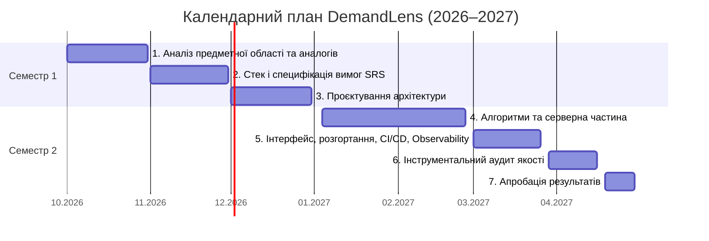

# Документація кваліфікаційної роботи DemandLens

Навігаційний дашборд пояснювальної записки (Documentation as Code).
Тема: «Інтелектуальна платформа виявлення та оцінювання ринкових можливостей».
Автор: Кока Максим Сергійович, 121/F2. Науковий керівник: —.

## Структура пояснювальної записки

| Файл | Розділ | Статус |
|---|---|---|
| [proposal.md](proposal.md) | Технічна картка проєкту (Thesis Proposal) | Готово |
| [0_intro.md](0_intro.md) | Вступ і науковий апарат | Готово |
| [1_analysis.md](1_analysis.md) | Розділ 1. Аналіз предметної області та постановка задачі | Скелет |
| [2_design.md](2_design.md) | Розділ 2. Обґрунтування архітектурних рішень та проєктування системи | Скелет |
| [3_implementation.md](3_implementation.md) | Розділ 3. Реалізація, тестування та розгортання | Скелет |
| [4_conclusions.md](4_conclusions.md) | Висновки | Скелет |

## Календарний план

| № з/п | Назва етапу кваліфікаційної роботи | Термін виконання етапів проєкту | Примітка / Статус виконання |
|---|---|---|---|
| 1 | Аналіз предметної області, програмних аналогів і підходів до виявлення ринкового попиту | 01.10.2026 – 31.10.2026 | In Progress |
| 2 | Обґрунтування технологічного стеку та специфікація вимог (SRS, ISO/IEC/IEEE 29148) | 01.11.2026 – 30.11.2026 | To Do |
| 3 | Проєктування архітектури системи (C4, UML, модель даних, OpenAPI) | 01.12.2026 – 31.12.2026 | To Do |
| 4 | Розробка алгоритмів критичних вузлів і базової серверної частини | 04.01.2027 – 26.02.2027 | To Do |
| 5 | Розробка клієнтського інтерфейсу, схеми розгортання, CI/CD і контуру Observability | 01.03.2027 – 26.03.2027 | To Do |
| 6 | Інструментальний аудит якості (pytest, k6, SonarQube, Trivy) | 29.03.2027 – 16.04.2027 | To Do |
| 7 | Апробація результатів (наукова стаття або тези доповіді) | 19.04.2027 – 30.04.2027 | To Do |

Травень 2027 року зарезервовано для нормоконтролю та передзахисту. Етапи 1–7 відповідають завданням
1–7 наукового апарату ([0_intro.md](0_intro.md#завдання-проєкту)).

## Мапа лабораторних робіт

| ЛР | Артефакти | Гілка |
|---|---|---|
| ЛР№1 | [proposal.md](proposal.md), [labs/lab-01](../labs/lab-01/) | `main` |
| ЛР№2 | [0_intro.md](0_intro.md), цей файл, скелет розділів, [labs/lab-02](../labs/lab-02/) | `feature/docs-skeleton` |
