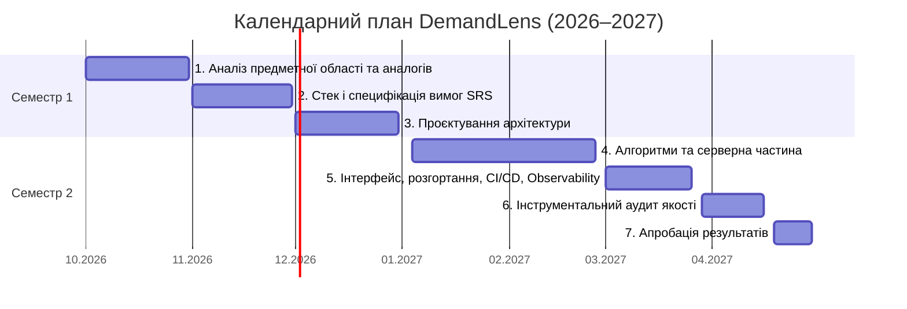

# Мета роботи

Спроєктувати архітектуру тексту кваліфікаційної роботи за методологією Docs-as-Code, сформулювати та
валідувати науковий апарат дослідження за допомогою генеративного ШІ, розгорнути двосеместровий
календарний план у PKM Workspace та ініціалізувати каркас пояснювальної записки в Git за професійним
Git-Workflow.

# Завдання 1. AI-асистоване проєктування наукового апарату

Науковий апарат сформовано на основі `docs/proposal.md` (ЛР№1) і перенесено на сторінку Notion
«Науковий апарат проєкту» та у файл `docs/0_intro.md`. Логічний зв'язок тріади: об'єкт (процес
виявлення попиту) містить предмет (методи і засоби збору, обробки й ранжування даних), мета поєднує
предмет і об'єкт та фіксує вимірюване покращення.

{{include ../../docs/0_intro.md shift=1 skip_h1}}

# Завдання 2. Календарний план і Timeline

База «Календарний план» у Notion заповнена сімома етапами; жодне поле не порожнє. Для бази створено
вигляд «Timeline (Roadmap)» за властивістю «Термін виконання етапів проєкту». Нижче наведено
відповідну діаграму Ганта (Mermaid), що повторює Timeline.

Таблиця 2.1 — Відповідність етапів календарного плану завданням наукового апарату

| Етап | Завдання наукового апарату | Термін | Статус |
|---|---|---|---|
| 1 | Проаналізувати предметну область і аналоги | 01.10.2026 – 31.10.2026 | In Progress |
| 2 | Обґрунтувати стек і сформувати SRS | 01.11.2026 – 30.11.2026 | To Do |
| 3 | Спроєктувати архітектуру (C4, UML, дані, OpenAPI) | 01.12.2026 – 31.12.2026 | To Do |
| 4 | Розробити алгоритми і базову серверну частину | 04.01.2027 – 26.02.2027 | To Do |
| 5 | Спроєктувати інтерфейс і схему розгортання | 01.03.2027 – 26.03.2027 | To Do |
| 6 | Провести інструментальний аудит якості | 29.03.2027 – 16.04.2027 | To Do |
| 7 | Апробувати результати | 19.04.2027 – 30.04.2027 | To Do |

# AI Insights

{{include ai-insights.md shift=1 skip_h1}}

# Завдання 3. Docs-as-Code каркас у Git

Створено гілку `feature/docs-skeleton` від `main`. У каталозі `/docs` розгорнуто файли `README.md`,
`0_intro.md`, `1_analysis.md`, `2_design.md`, `3_implementation.md`, `4_conclusions.md`. Науковий апарат
зверстано заголовками `# ВСТУП` і `## Об'єкт дослідження` тощо; календарний план у `README.md` подано
Markdown-таблицею з реальними датами. Зміни зафіксовано комітом
`docs: initialize thesis skeleton and add scientific apparatus`; відкрито Pull Request у `main` без
злиття.

# Висновки

Сформовано науковий апарат кваліфікаційної роботи: об'єкт визначено як процес, предмет — як методи і
технології стеку, мету — з вимірюваним якісним покращенням, сім завдань відтворюють інженерний
pipeline. Календарний план із семи етапів синхронізовано із завданнями та візуалізовано на Timeline без
часових конфліктів. Каркас пояснювальної записки ініціалізовано в Git через feature-гілку і Pull
Request.
