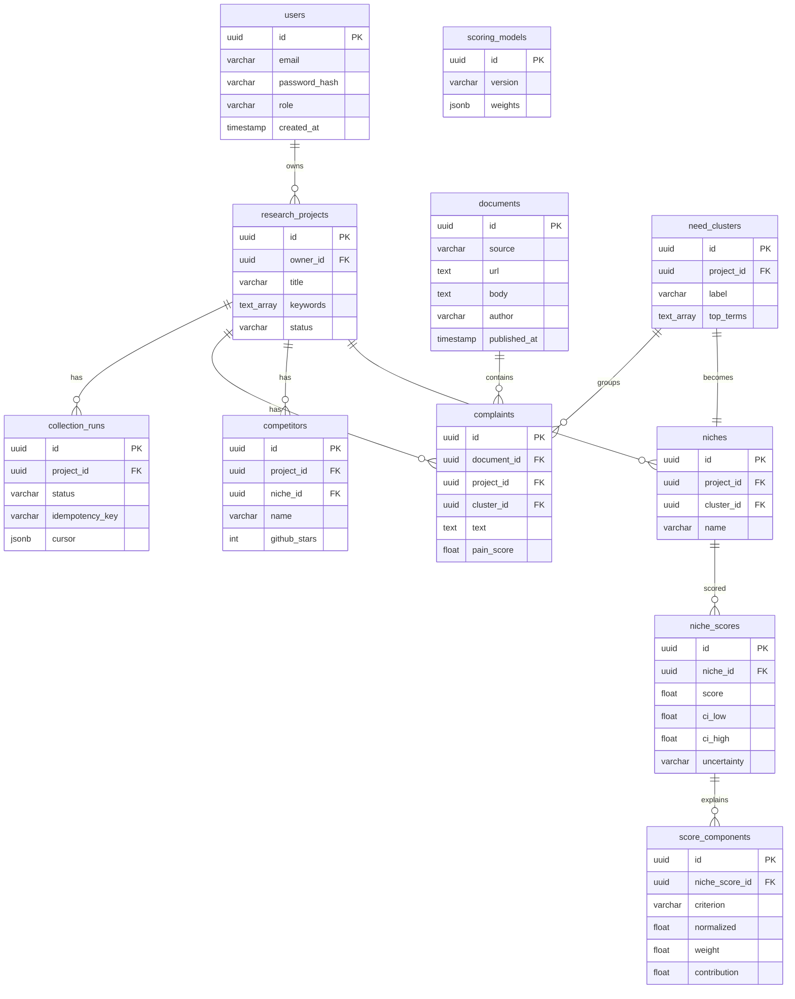

# Перша версія моделі даних (до аудиту)

Чернетка сформована на етапі «рамки» (DECISIONS.md, редакція до ЛР№6) і зафіксована для протоколу
AI Insights. Фінальна версія — `docs/2_design.md`, підрозділ 2.7.

